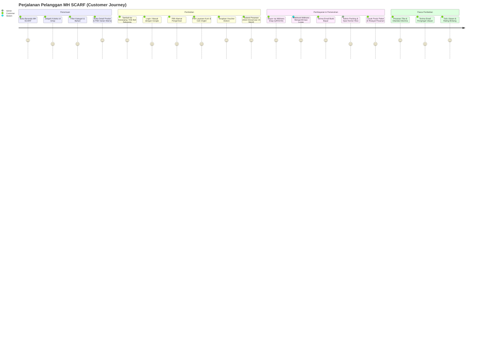

# Product Requirement Document (PRD) — MH SCARF

## Website E-Commerce Hijab & Modest Fashion — MH SCARF Store

**Status:** In Development / Production Staging  
**Konsep Visual:** Soft Luxury Feminine + Floral Elegant  
**Brand Positioning:** *"Luxury feminine hijab boutique meets modern Indonesian e-commerce."*  
**Platform & Infrastruktur:** Laravel 13 (PHP 8.3/8.5), Tailwind CSS v4, Vite 8, Clever Cloud (MySQL), Supabase Storage (S3 API), Midtrans Snap Sandbox, RajaOngkir / Komerce API V2, Resend Email API, Vercel Serverless.

---

## 1. Ringkasan Produk dan Latar Belakang

**MH SCARF** adalah platform e-commerce butik hijab dan aksesori modest fashion modern yang menyajikan pengalaman belanja digital premium, anggun, dan tanpa hambatan (*frictionless*). 

Banyak konsumen modest fashion di Indonesia mengeluhkan pengalaman belanja di marketplace umum yang terlalu ramai, dipenuhi iklan diskon yang agresif, sulit menilai keaslian warna bahan, dan antarmuka yang membingungkan. MH SCARF hadir sebagai destinasi butik online khusus yang mengedepankan kurasi visual yang tenang, estetika *soft luxury*, akurasi ketersediaan stok, kalkulasi ongkos kirim domestik presisi, dan pembayaran digital otomatis terpercaya.

Bagi pemilik bisnis (owner/admin), sistem ini menyediakan kendali operasional terpadu: pengelolaan katalog produk dan varian multi-warna, pengawasan stok real-time dengan mekanisme reservasi saat checkout, integrasi pesanan dan pembayaran otomatis Midtrans, pencetakan resi dan pelacakan pengiriman ekspedisi, serta wawasan pendapatan operasional.

---

## 2. Tujuan Bisnis dan Tujuan Pengguna

### 2.1 Tujuan Bisnis (Business Objectives)
1. **Membangun Saluran Penjualan Langsung (DTC):** Mengurangi ketergantungan pada marketplace pihak ketiga dengan komisi tinggi dan perang harga.
2. **Memperkuat Brand Equity MH SCARF:** Memposisikan brand sebagai pionir hijab premium berestetika *soft luxury* dengan palet warna khas (ivory, dusty rose, mauve, charcoal).
3. **Meningkatkan Nilai Rata-rata Pesanan (AOV):** Mendorong pembelian berulang melalui penawaran voucher belanja, rekomendasi produk sejenis (*related products*), dan katalog koleksi berkala.
4. **Efisiensi Operasional Toko:** Otomatisasi verifikasi pembayaran melalui webhook payment gateway Midtrans dan otomatisasi kalkulasi ongkos kirim via RajaOngkir/Komerce V2 tanpa verifikasi manual via chat WhatsApp.
5. **Mencegah Masalah Overselling & Abandonment:** Menerapkan sistem penahanan (*reservation*) stok 15 menit dan pemulihan stok otomatis jika pembayaran kedaluwarsa.

### 2.2 Tujuan Pengguna (User Objectives)
1. **Pengalaman Belanja Anggun & Mudah:** Menemukan hijab idaman berdasarkan kategori, bahan, dan warna secara cepat pada perangkat smartphone (mobile-first).
2. **Kepastian Varian & Stok:** Mendapatkan informasi akurat mengenai ketersediaan warna hijab, detail ukuran, dan panduan perawatan (*care instructions*).
3. **Checkout Transparan:** Mengetahui estimasi ongkir riil ke kecamatan tujuan dan menyelesaikan pembayaran instan via QRIS, Virtual Account, atau E-Wallet dalam hitungan detik.
4. **Pelacakan Transparan:** Memantau posisi paket pesanan secara langsung melalui nomor resi ekspedisi dan menerima pembaruan email transaksional.

---

## 3. Target Pengguna dan Persona

### 3.1 Target Pasar
- **Pasar Utama:** Perempuan muslimah Indonesia usia 18–35 tahun, pengguna smartphone aktif, gemar berbelanja modest fashion via media sosial (Instagram/TikTok).
- **Geografis:** Seluruh wilayah Indonesia (jangkauan ekspedisi nasional JNE, POS, TIKI, SiCepat, J&T).
- **Preferensi:** Mengutamakan kenyamanan bahan hijab (Voal Premium, Silk, Satin, Ceruty), keaslian foto produk, kemudahan pembayaran QRIS/VA, dan kecepatan pengiriman.

### 3.2 Persona Pengguna

#### Persona 1: Alya (21 tahun) — Mahasiswi
- **Karakteristik:** Trendi, aktif di TikTok/Instagram, menyukai hijab praktis untuk kuliah dan hangout.
- **Kebutuhan:** Hijab voal harian bernuansa pastel, harga transparan, promo voucher pengguna baru, pembayaran instan QRIS/GoPay.
- **Pain Point:** Ragu warna pada foto berbeda dengan aslinya, ongkir mahal ke luar kota besar.

#### Persona 2: Nadia (28 tahun) — Profesional Muda
- **Karakteristik:** Bekerja di perkantoran, menghargai waktu, mencari hijab rapi dan elegan untuk formal & kasual.
- **Kebutuhan:** Filter pencarian cepat berdasarkan bahan dan warna, fitur *Beli Sekarang* (*Buy Now*) langsung ke checkout, invoice otomatis di email.
- **Pain Point:** Varian warna favorit sering habis mendadak di toko lain, antarmuka checkout yang berbelit-belit.

#### Persona 3: Rina (33 tahun) — Ibu Muda
- **Karakteristik:** Mengutamakan kenyamanan, bahan adem, dan kemudahan perawatan pakaian keluarga.
- **Kebutuhan:** Informasi detail material dan panduan cuci (*care instructions*), ulasan pembeli asli (*verified purchase*), kemudahan login via Google.
- **Pain Point:** Takut barang salah kirim atau pesanan gantung tanpa konfirmasi.

#### Persona 4: Owner / Admin Toko MH SCARF
- **Karakteristik:** Mengelola inventaris, pesanan, dan pemenuhan ekspedisi dengan tim operasional kecil.
- **Kebutuhan:** Dashboard ringkas menampilkan pesanan yang perlu diproses, kontrol input resi pengiriman, pencegahan stok minus, serta moderasi ulasan.
- **Pain Point:** Rekap transfer manual membuang waktu, resiko pembeli transfer saat stok barang sudah habis.

---

## 4. Ruang Lingkup Sistem (Scope of System)

Sistem MH SCARF mencakup:
1. **Storefront Publik (Mobile-First):** Beranda estetik, katalog koleksi, detail produk & varian, pencarian kata kunci, filtering kategori dan produk diskon (*Sale*), serta artikel jurnal fashion.
2. **Manajemen Akun Customer:** Registrasi, login manual, Google OAuth SSO, reset password, profil, buku alamat pengiriman multi-entri, riwayat transaksi, dan daftar keinginan (*wishlist*).
3. **Keranjang & Checkout Idempotent:** Sesi keranjang tamu dan pelanggan, penggabungan keranjang saat login, direct checkout (*Buy Now*), kalkulasi ongkir real-time kecamatan, penerapan kode voucher, penahanan stok atomik, dan pencegahan submit ganda.
4. **Gateway Pembayaran & Webhook:** Inisialisasi token Midtrans Snap dengan sewa basis data, verifikasi signature webhook, penyesuaian status otomatis, dan pembatalan otomatis (*sweeper*) untuk pesanan kedaluwarsa.
5. **Ekspedisi & Pelacakan:** Integrasi API RajaOngkir / Komerce V2 untuk tarif dan pelacakan status resi pengiriman AWB dengan proteksi batas panggil (*cooldown cache*).
6. **Email Transaksional:** Notifikasi konfirmasi pesanan, bukti bayar lunas, notifikasi resi pengiriman, dan pengingat ulasan via Resend API.
7. **Panel Administrasi (Backoffice):** Dashboard KPI operasional, kelola kategori, produk, varian multi-warna, galeri foto Supabase, kelola stok/mutasi fisik, pemrosesan pesanan, input resi, voucher promo, dan moderasi ulasan.

---

## 5. Aktor Sistem dan Hak Akses

| Aktor | Peran Utama | Hak Akses Utama |
|---|---|---|
| **Guest (Pengunjung Tamu)** | Menjelajah dan mencoba belanja | Melihat beranda, katalog, detail produk, jurnal, FAQ; menambah item ke keranjang tamu; simulasi pilihan varian; diarahkan login/register saat checkout. |
| **Customer (Pelanggan)** | Membeli produk dan mengelola akun | Menambah wishlist; checkout keranjang dan Beli Sekarang; mengelola buku alamat; membayar via Midtrans; melacak pengiriman; memberi ulasan produk pada pesanan selesai; login via Google. |
| **Admin / Owner** | Pengelola bisnis dan operasional | Mengakses panel `/admin`; mengelola katalog, stok, dan gambar; memproses pesanan dan resi pengiriman; membuat voucher diskon; memoderasi ulasan; memantau metrik penjualan. |
| **System / Background Scheduler** | Otomatisasi tugas latar belakang | Melepas stok pesanan kedaluwarsa (`orders:release-expired`); mengirim email pengingat ulasan 24 jam pasca tiba (`reviews:send-reminders`); menerima webhook Midtrans. |

---

## 6. User Journey Utama

---

## 7. Functional Requirements (Spesifikasi Fitur)

### F-01 Beranda Toko (Homepage)
- **Tujuan:** Menampilkan citra butik *soft luxury* dan mengarahkan pembeli ke koleksi hijab unggulan.
- **Komponen Aktual:** Hero banner statis dengan typography Playfair/Instrument Sans, Featured Category mosaic, Best Seller Collection (4 produk), New Arrivals (4 produk), Material Spotlight (daftar bahan Voal/Silk/Satin), Active Voucher promo bar, dan Testimonial ulasan terverifikasi.
- **Logika:** Kategori dan produk ditarik secara dinamis dari database (hanya produk dan kategori yang berstatus `is_active = true`).
- **Status:** **Implemented**.

### F-02 Katalog & Navigasi Produk (/shop)
- **Tujuan:** Mempermudah penemuan hijab dengan antarmuka yang bersih dan responsif.
- **Input & Filter:** Pilihan kategori via slug URL (`/shop/{category:slug}`), pencarian kata kunci nama/deskripsi/material (`q`), filter produk diskon (`sale=1`), dan sorting (`newest`, `price_asc`, `price_desc`, `best_seller`).
- **Logika:** Paginasi 12 item per halaman. Produk dengan stok 0 tetap tampil dengan label penanda habis.
- **Status:** **Implemented**.

### F-03 Detail Produk & Pemilihan Varian (/shop/produk/{slug})
- **Tujuan:** Memberikan informasi lengkap mengenai hijab untuk meningkatkan keyakinan beli.
- **Output:** Galeri multi-gambar dengan penanda foto utama, pilihan varian warna dengan swatch/nama dan harga dinamis, deskripsi bahan, panduan perawatan (*care instructions*), total stok riil, ulasan pembeli terverifikasi beserta breakdown bintang, serta rekomendasi produk sejenis (*related products*) dalam kategori yang sama.
- **Interaksi:** Tombol *Tambah ke Keranjang* dan *Beli Sekarang* (*Buy Now* yang langsung mengarahkan sesi ke checkout tanpa melewati keranjang).
- **Status:** **Implemented**.

### F-04 Keranjang Belanja (/cart)
- **Tujuan:** Tempat penampungan sementara barang yang diminati sebelum checkout.
- **Fitur:** Tambah item varian, ubah kuantitas (dibatasi stok maksimum varian), hapus item, dan kosongkan keranjang.
- **Logika:** Keranjang tamu menggunakan `session_id`. Ketika tamu melakukan login atau registrasi, `CartService::mergeGuestCart()` secara otomatis memindahkan item ke keranjang akun customer. Harga unit selalu dihitung ulang di server dari harga varian aktif.
- **Status:** **Implemented**.

### F-05 Daftar Keinginan (Wishlist)
- **Tujuan:** Menyimpan hijab favorit untuk dibeli di kemudian hari.
- **Fitur:** Toggle tombol hati pada kartu produk dan detail produk untuk customer terautentikasi. Halaman daftar wishlist di `/wishlist`.
- **Status:** **Implemented**.

### F-06 Buku Alamat Pengiriman (/addresses)
- **Tujuan:** Mengelola daftar alamat tujuan kirim customer.
- **Fitur:** CRUD alamat (label, nama penerima, nomor telepon, alamat jalan, kelurahan, kecamatan, kota, provinsi, kode pos, patokan), serta pengaturan alamat utama (*default address*).
- **Status:** **Implemented**.

### F-07 Alur Checkout Terproteksi (/checkout)
- **Tujuan:** Menyelesaikan pemesanan secara akurat, aman dari submit ganda, dan konsisten terhadap stok.
- **Logika & Bisnis Rules:**
  - Wajib login customer (autentikasi).
  - Pilihan alamat pengiriman tervalidasi milik user.
  - Pencarian lokasi tujuan RajaOngkir/Komerce V2 via AJAX dan pemilihan paket kurir (JNE, POS, TIKI, dll.).
  - Total berat paket dihitung dari akumulasi `weight_gram` setiap varian item.
  - Perhitungan ulang subtotal, diskon voucher, dan ongkir dilakukan secara ketat di server.
  - **Proteksi Idempotensi:** Form checkout menyertakan `checkout_token` (UUID) dan payload fingerprint. Request ganda dengan token yang sama akan mengembalikan pesanan yang telah terbentuk tanpa membuat transaksi baru.
  - **Stock Reservation:** Memotong stok fisik dan mencatat reservasi berbatas waktu (15 menit) pada `stock_reservations`.
  - **Snapshot:** Snapshot nama produk, varian, SKU, harga, alamat kirim, dan opsi kurir disimpan permanen pada `order_items` dan `shipments`.
- **Status:** **Implemented**.

### F-08 Pembayaran Otomatis Midtrans (/orders/{order}/payment & Webhook)
- **Tujuan:** Memfasilitasi pembayaran non-tunai yang aman dan otomatis.
- **Fitur:**
  - Pembuatan Snap Token Midtrans dengan sewa baris basis data (`payment_initialization_attempts`) untuk mencegah duplikasi token pada request paralel.
  - Halaman antarmuka pembayaran dengan tombol bayar Snap popup (mendukung GoPay, ShopeePay, QRIS, BCA/BRI/BNI/Mandiri VA).
  - Endpoint Webhook publik `/webhooks/payment` dengan verifikasi signature hash SHA512 dan verifikasi kesesuaian nominal tagihan.
  - Transisi status otomatis pesanan ke `confirmed` saat webhook `settlement`/`capture` diterima, dan reservasi stok dikonfirmasi permanen.
  - Fallback polling status berkala (`syncFromGateway`) pada halaman pembayaran pelanggan.
  - Perintah terjadwal `php artisan orders:release-expired` untuk membatalkan pesanan kedaluwarsa dan melepas kembali stok ke etalase.
- **Status:** **Implemented**.

### F-09 Manajemen Ekspedisi & Pelacakan Resi
- **Tujuan:** Memberikan kepastian pengiriman paket hijab kepada pembeli.
- **Fitur:**
  - Admin dapat memperbarui status pesanan menjadi `shipped` dengan memasukkan kurir, layanan, dan nomor resi pengiriman (AWB).
  - Pelacakan posisi paket secara live melalui integrasi RajaOngkir / Komerce Waybill API (`ShipmentTrackingService`).
  - Proteksi kuota API pelacakan dengan jeda (*cooldown cache*) 5 menit per nomor resi.
- **Status:** **Implemented**.

### F-10 Ulasan & Rating Produk Terverifikasi
- **Tujuan:** Membangun *social proof* dan kepercayaan calon pembeli baru.
- **Fitur:**
  - Ulasan hanya dapat diberikan oleh customer yang membeli produk terkait setelah pesanan berstatus `delivered` atau `completed` (*verified purchase*).
  - Satu ulasan per baris `order_items`.
  - Input rating bintang 1–5 dan komentar ulasan.
  - Rata-rata rating (`rating_avg`) dan jumlah ulasan (`rating_count`) pada produk diperbarui secara otomatis dan atomik.
  - Admin dapat menyembunyikan atau menampilkan ulasan melalui tombol toggle moderasi.
  - Unggah foto ulasan: **Partially Implemented** (Kolom database `photo_path` tersedia, namun form frontend saat ini belum menyertakan input unggah berkas foto).
- **Status:** **Partially Implemented**.

### F-11 Promosi & Kode Voucher
- **Tujuan:** Menstimulasi konversi transaksi dan apresiasi pelanggan.
- **Fitur:**
  - Tiga tipe voucher: `percentage` (persentase dengan plafon `max_discount_amount`), `fixed` (nominal rupiah tetap), dan `free_shipping` (potongan ongkir).
  - Validasi syarat batas belanja minimum (`min_order_amount`), tanggal berlaku (`starts_at` s.d. `expires_at`), batas kuota global (`usage_limit`), dan kuota per pelanggan (`usage_limit_per_user`).
  - Pratinjau kalkulasi diskon voucher via AJAX di halaman checkout.
  - Penguncian baris voucher dengan `lockForUpdate()` saat pesanan dibuat agar kuota tidak terpakai melebihi batas.
  - Kuota dikembalikan otomatis jika pesanan dibatalkan atau pembayaran kedaluwarsa.
  - Panel Admin untuk membuat, mengubah, dan menonaktifkan voucher.
- **Status:** **Implemented**.

### F-12 Notifikasi Email Transaksional (Resend)
- **Tujuan:** Komunikasi formal transaksi ke alamat email customer.
- **Fitur:**
  - Email pesanan dibuat (`OrderPlacedMail`).
  - Email konfirmasi pembayaran berhasil (`PaymentReceivedMail`).
  - Email pesanan dikirim beserta nomor resi (`ShipmentDispatchedMail`).
  - Email pengingat ulasan produk 24 jam setelah pesanan diterima (`ReviewReminderMail`).
- **Status:** **Implemented**.

### F-13 Panel Dashboard & Operasional Admin (/admin)
- **Tujuan:** Pusat kendali operasional pemilik butik MH SCARF.
- **Fitur:**
  - Login khusus admin dengan rate limiting ketat (`throttle:admin-login`).
  - Dashboard ringkasan: Total omzet lunas, jumlah pesanan menunggu bayar, pesanan perlu dikirim, jumlah produk aktif, unit stok gudang, peringatan varian menipis (*low stock*), dan pesanan yang memerlukan perhatian pengembalian dana (*refund needed*).
  - Kelola Kategori (CRUD + unggah gambar banner ke Supabase).
  - Kelola Produk (CRUD + status aktif/draft, flag best seller, flag featured).
  - Kelola Varian Produk (Tambah varian warna/ukuran, penyesuaian stok fisik via `InventoryService`, update berat).
  - Kelola Gambar Produk (Unggah berkas gambar ke Supabase Storage, atur foto utama, hapus foto).
  - Kelola Pesanan (Filter status, detail pesanan lengkap, transisi state machine terstandarisasi, pembatalan pesanan dengan pengembalian stok otomatis, input resi pengiriman, tandai refund).
  - Kelola Voucher (CRUD, toggle keaktifan kupon).
  - Moderasi Ulasan (Daftar ulasan pembeli, toggle publikasi `is_published`).
- **Status:** **Implemented**.

### F-14 Fitur Terencana / Parsial (Planned & Dormant Modules)
- **Banner Promo Dinamis (`banners`):** Tabel database dan model Eloquent sudah tersedia, namun belum ada Admin CRUD atau integrasi dinamis pada beranda (saat ini banner beranda bersifat statis). **Status: Planned**.
- **Notifikasi In-App Pelanggan (`notifications`):** Tabel dan relasi user sudah ada, namun antarmuka kotak masuk notifikasi di profil customer belum dibuat. **Status: Planned**.
- **Pencatatan Riwayat Tampilan Produk (`product_views`):** Tabel dan model tersedia, namun pemanggilan penyimpanan *view log* pada `CatalogController` belum diaktifkan. **Status: Planned**.
- **Laporan Penjualan Ekspor PDF/Excel:** Saat ini data metrik tersedia di dashboard visual, namun fitur ekspor berkas belum diimplementasikan. **Status: Planned**.

---

## 8. Non-Functional Requirements (NFR)

| ID | Parameter | Spesifikasi & Kondisi Aktual |
|---|---|---|
| **NFR-SEC-01** | Keamanan Autentikasi | Password di-hash menggunakan algoritma Bcrypt (12 rounds). Proteksi login brute-force menggunakan middleware throttle (5 percobaan/menit untuk customer, batas tersendiri untuk admin). |
| **NFR-SEC-02** | Proteksi CSRF & Webhook | Seluruh form dan request POST/PUT/PATCH/DELETE wajib menyertakan token CSRF. Endpoint webhook Midtrans dikecualikan dari CSRF namun diproteksi verifikasi signature SHA512. |
| **NFR-SEC-03** | Pembayaran Tanpa Simpan Kartu | Sistem MH SCARF mematuhi standar PCI-DSS dengan tidak menyimpan nomor kartu kredit atau CVV di database; seluruh transaksi diproses via Midtrans Hosted Snap Token. |
| **NFR-PERF-01** | Waktu Muat Halaman | Waktu muat beranda dan katalog ditargetkan LCP < 2.5 detik pada jaringan 4G. Asset CSS dan JS di-bundle menggunakan Vite 8 dan Tailwind CSS v4 berukuran ringan (< 130 KB CSS gzipped). |
| **NFR-PERF-02** | Efisiensi Basis Data | Eager loading diterapkan pada relasi kritis katalog dan checkout (`with(['category', 'images', 'variants'])`) untuk mencegah query N+1. |
| **NFR-REL-01** | Ketahanan Konkurensi Transaksi | Penguncian baris basis data (`lockForUpdate()`) diterapkan saat checkout, reservasi stok, klaim Midtrans Snap, dan pembatalan pesanan untuk menjamin integritas ACID. |
| **NFR-REL-02** | Isolasi Serverless Vercel | Karena Vercel menggunakan multi-instance terisolasi dengan `CACHE_STORE=array`, kunci idempotensi dan sewa status transaksi mengandalkan database relasional Clever Cloud, bukan in-memory cache lokal. |
| **NFR-USA-01** | Desain Mobile-First | Antarmuka dirancang responsif mulai resolusi 360px, dengan target sentuh tombol minimal 44x44px dan navigasi jempol yang nyaman. |
| **NFR-USA-02** | Konsistensi Brand Luxury | Gaya visual mematuhi palet warna soft luxury (ivory, dusty rose, mauve, charcoal) dengan tipografi Playfair Display dan Instrument Sans. |

---

## 9. Aturan Bisnis (Business Rules)

1. **Aturan Harga Produk:**
   - Harga final varian dihitung dari `products.base_price` + `product_variants.additional_price`.
   - Diskon coret hanya tampil di antarmuka jika `products.compare_at_price` terisi dan bernilai lebih besar dari `base_price`.
2. **Aturan Stok & Penahanan (Reservation):**
   - Kuantitas yang dapat dibeli customer tidak boleh melebihi `product_variants.stock_qty`.
   - Ketika pesanan disubmit pada checkout, kuantitas stok langsung dipotong dan dicatat pada tabel `stock_reservations` dengan status `pending` selama 15 menit.
   - Jika pembayaran berhasil diverifikasi sebelum batas waktu, reservasi stok beralih menjadi `reserved`.
   - Jika pembayaran melewati batas waktu atau pesanan dibatalkan, kuantitas stok dikembalikan ke varian via `InventoryService` dengan mutasi bertipe `'return'`, dan status reservasi diubah menjadi `'released'`.
3. **Aturan State Machine Pesanan:**
   - Alur status pesanan mengikuti transisi satu arah:  
     `pending` &rarr; `confirmed` &rarr; `processing` &rarr; `packed` &rarr; `shipped` &rarr; `delivered` &rarr; `completed`.
   - Pesanan hanya dapat dibatalkan (`cancelled`) jika statusnya masih `pending`, `confirmed`, `processing`, atau `packed`. Pesanan yang sudah berstatus `shipped`, `delivered`, atau `completed` tidak dapat dibatalkan melalui sistem otomatis.
   - Pesanan hanya boleh diubah menjadi `shipped` oleh admin jika status pembayaran sudah `paid` serta nama kurir, layanan, dan nomor resi pengiriman telah diisi lengkap.
4. **Aturan Kupon & Voucher:**
   - Satu transaksi checkout hanya dapat menggunakan maksimal 1 kode voucher.
   - Nilai potongan voucher tidak boleh melebihi nilai subtotal belanja (atau tidak melebihi ongkir untuk voucher bertipe `free_shipping`).
   - Kuota pemakaian voucher (`used_count`) langsung ditambah saat pesanan terbuat, dan akan dikembalikan (di-decrement) jika pesanan tersebut dibatalkan.
5. **Aturan Pembayaran Terlambat & Refund:**
   - Jika notifikasi pembayaran lunas dari Midtrans tiba pada pesanan yang sudah terlanjur berstatus `cancelled` (pembeli membayar saat stok sudah dilepas ke pembeli lain), pesanan **tidak diaktifkan kembali**. Sistem mencatat metadata `needs_refund = true` agar admin melakukan pengembalian dana manual.
6. **Aturan Ulasan Pelanggan:**
   - Customer hanya dapat memberikan ulasan pada produk dari pesanan yang telah berstatus `delivered` atau `completed`.
   - Setiap baris item pembelian (`order_items`) hanya memiliki hak 1 kali ulasan.

---

## 10. Prioritas Fitur

| Prioritas | Modul / Fitur | Status Implementasi | Catatan Rilis |
|---|---|---|---|
| **P0 (Kritis/MVP)** | Katalog Produk, Detail Varian, Galeri Gambar | **Implemented** | Berjalan di storefront |
| **P0 (Kritis/MVP)** | Keranjang, Beli Sekarang (Buy Now), Guest Merge | **Implemented** | Berjalan di storefront |
| **P0 (Kritis/MVP)** | Autentikasi Customer (Manual & Google OAuth) | **Implemented** | Berjalan di storefront |
| **P0 (Kritis/MVP)** | Checkout Idempotent & Reservasi Stok 15 Menit | **Implemented** | Berjalan dengan database lock |
| **P0 (Kritis/MVP)** | Integrasi Ongkir RajaOngkir / Komerce V2 | **Implemented** | Hitung tarif real-time |
| **P0 (Kritis/MVP)** | Gateway Pembayaran Midtrans Snap & Webhook | **Implemented** | Otomatisasi settlement & cancel |
| **P0 (Kritis/MVP)** | Panel Admin: Produk, Varian, Kategori, Pesanan | **Implemented** | Akses terbatas middleware admin |
| **P1 (Penting)** | Pelacakan Resi Ekspedisi (Waybill Tracking) | **Implemented** | Dilengkapi cooldown 5 menit |
| **P1 (Penting)** | Email Transaksional Resend (Order, Bayar, Resi) | **Implemented** | Template email siap pakai |
| **P1 (Penting)** | Fitur Voucher Diskon & Pratinjau Checkout | **Implemented** | Dilengkapi validasi atomik |
| **P1 (Penting)** | Ulasan & Rating Produk Terverifikasi | **Implemented** | Perhitungan rating otomatis |
| **P2 (Dukungan)** | Unggah Foto Ulasan Pembeli | **Partially Implemented** | Kolom siap, form frontend belum |
| **P2 (Dukungan)** | Pengingat Ulasan Otomatis 24 Jam Pasca Kirim | **Implemented** | Command scheduler tersedia |
| **P3 (Rencana/Fase 2)**| Kelola Banner Promo Dinamis dari Admin | **Planned** | Schema & Model ada |
| **P3 (Rencana/Fase 2)**| Notifikasi In-App Pelanggan | **Planned** | Schema & Model ada |
| **P3 (Rencana/Fase 2)**| Log Analitik Tampilan Produk (`product_views`) | **Planned** | Schema & Model ada |
| **P3 (Rencana/Fase 2)**| Ekspor Laporan Finansial PDF/Excel | **Planned** | Rencana rilis berikutnya |

---

## 11. Integrasi Pihak Ketiga

1. **Midtrans Payment Gateway (Snap API):**
   - Mode: Sandbox (siap beralih ke Production via konfigurasi env).
   - Fitur terverifikasi: Pembuatan Snap Token, popup pembayaran, webhook signature verification SHA512, auto settlement, fallback polling status, dan sweeper pelepasan stok kadaluwarsa.
2. **RajaOngkir / Komerce Shipping Cost V2 (`https://rajaongkir.komerce.id/api/v1`):**
   - Fitur terverifikasi: Pencarian subdistrict/kecamatan domestik (`/destination/domestic-destination`), kalkulasi tarif kurir domestik (`/calculate/domestic-cost`), dan pelacakan resi ekspedisi (`/track/waybill`).
3. **Resend Email API (`api.resend.com`):**
   - Driver: Custom transport `TimedResendTransport` dengan penanganan timeout koneksi.
   - Fitur terverifikasi: Pengiriman email konfirmasi pesanan, konfirmasi pembayaran, pengiriman paket, dan reminder ulasan.
4. **Supabase Storage:**
   - Driver: AWS S3 kompatibel via `league/flysystem-aws-s3-v3`.
   - Fitur terverifikasi: Penyimpanan aset gambar produk dan kategori pada bucket `mh-scarf-images`.
5. **Google Identity Platform (Socialite):**
   - Fitur terverifikasi: Login satu klik pelanggan dengan verifikasi email Google otomatis dan proteksi akun admin.
6. **Clever Cloud & Vercel:**
   - Database MySQL dihosting pada Clever Cloud.
   - Aplikasi dideploy pada platform Vercel Serverless melalui custom runtime bridge `api/index.php` dan `launcher.js`.

---

## 12. Batasan dan Asumsi

### Batasan (Constraints)
1. **Serverless Cache Limitation:** Lingkungan Vercel menggunakan multi-instance independen di mana `CACHE_STORE` diset ke `array`. Hal ini berarti cache in-memory tidak terbagi antar proses serverless. Oleh karena itu, penguncian data penting (idempotensi pembayaran dan reservasi stok) wajib menggunakan transaksi database MySQL di Clever Cloud.
2. **Pengiriman Domestik:** Sistem saat ini hanya melayani pengiriman dalam wilayah Republik Indonesia yang terdaftar pada direktori RajaOngkir/Komerce V2.
3. **Single Currency:** Seluruh perhitungan harga, diskon, dan transaksi moneter hanya menggunakan mata uang Rupiah (IDR).
4. **Metode Pembayaran:** Mengandalkan kanal pembayaran digital Midtrans; tidak melayani transfer manual rekening pribadi tanpa gateway.

### Asumsi Bisnis yang Perlu Dikonfirmasi Pemilik Toko
1. **Kebijakan Pengembalian Barang (Retur):** Alur retur fisik barang saat ini belum memiliki form otomatis di akun pelanggan (saat ini ditangani via komunikasi manual admin).
2. **Ketersediaan Opsi COD:** Saat ini opsi COD dimatikan di checkout dan diarahkan penuh ke Midtrans; perlu konfirmasi apakah butik akan mengaktifkan COD di area tertentu.
3. **Integrasi WhatsApp Business:** Apakah perlu ditambahkan tombol notifikasi status pesanan langsung via WhatsApp Gateway resmi di samping email Resend.

---

## 13. Kriteria Keberterimaan (Acceptance Criteria) Ringkas

1. **Katalog & Detail:** Pelanggan dapat memfilter hijab berdasarkan bahan dan kategori, melihat foto varian warna, serta membaca ulasan riil pembeli lain tanpa error antarmuka.
2. **Kalkulasi Checkout:** Subtotal, ongkos kirim berdasarkan berat total paket, dan potongan voucher terhitung presisi di sisi server sebelum pesanan dibuat.
3. **Pencegahan Overselling:** Jika varian hijab tersisa 1 pcs, maka 2 pelanggan yang checkout bersamaan tidak akan keduanya berhasil; pelanggan kedua akan menerima pesan bahwa stok tidak mencukupi.
4. **Otomatisasi Pembayaran:** Ketika pelanggan membayar via QRIS/VA, status pesanan di database otomatis berubah menjadi `confirmed` tanpa intervensi admin manual.
5. **Keamanan Transaksi:** Percobaan reload browser saat submit checkout atau pembayaran tidak menduplikasi tagihan atau token Snap.

---

## 14. Status Fitur Saat Ini (Hasil Audit Repository)

- **Implemented (Selesai & Berfungsi Didukung Kode & Pengujian):**
  - Autentikasi Pelanggan (Email/Password & Google OAuth).
  - Katalog Publik, Pencarian, Filter Kategori, Filter Diskon, Sorting Harga/Terbaru/Terlaris.
  - Detail Produk, Galeri Gambar, Penanganan Varian Warna & Ukuran.
  - Keranjang Belanja, Penggabungan Keranjang Tamu (*Guest Merge*), Alur *Buy Now*.
  - Buku Alamat Pengiriman Multi-Entri.
  - Checkout Idempotent dengan Proteksi Token & Fingerprint.
  - Reservasi Stok Berbatas Waktu (15 Menit) & Pengembalian Stok Otomatis.
  - Integrasi Midtrans Snap & Webhook Handler Aman (Signature Hash SHA512).
  - Background Command Pembatalan Pesanan Kedaluwarsa (`orders:release-expired`).
  - Kalkulasi Tarif Domestik RajaOngkir / Komerce V2 & Pelacakan Resi Ber-cooldown.
  - Notifikasi Email Transaksional via Resend API.
  - Ulasan Produk Terverifikasi Pembelian & Auto-update Rating Agregat.
  - Kode Voucher (Persentase, Nominal, Gratis Ongkir) & Validasi Atomik.
  - Panel Admin: Dashboard Metrik, CRUD Kategori, CRUD Produk, Kelola Varian & Stok, Unggah Foto ke Supabase Storage, Pemrosesan Pesanan & Resi, Kelola Voucher, Moderasi Ulasan.
- **Partially Implemented (Tersedia Sebagian / Terbatas):**
  - Unggah Foto Ulasan Pembeli (Schema tabel `reviews.photo_path` ada, form input foto ulasan belum aktif di antarmuka pembeli).
  - Audit Mutasi Stok Admin (Pencatatan data mutasi di tabel `inventory_movements` berjalan, namun belum ada halaman visual tabel riwayat mutasi khusus di admin).
- **Planned / Dormant (Schema atau Kebutuhan Terdefinisi, Belum Berjalan di Runtime):**
  - Banner Dinamis Toko (`banners`).
  - Notifikasi Dalam Aplikasi (`notifications`).
  - Pelacakan Tampilan Produk (`product_views`).
  - Ekspor Laporan Penjualan (CSV/Excel/PDF).
  - Rekomendasi Machine Learning (Saat ini menggunakan related products berbasis kategori).

---

## 15. Rencana Pengembangan Berikutnya (Roadmap)

### Fase 1: Penyempurnaan Rilis Saat Ini (Current Polish)
- Mengaktifkan input unggah foto ulasan hijab pada form ulasan pembeli ke Supabase Storage.
- Membuat antarmuka tabel log riwayat mutasi stok (`inventory_movements`) di panel admin untuk mempermudah audit fisik gudang.
- Mengaktifkan controller pengelolaan banner promo dinamis dari tabel `banners` agar banner beranda dapat diganti tanpa menyentuh kode Blade.

### Fase 2: Peningkatan Pengalaman Pelanggan (Growth & Engagement)
- Integrasi notifikasi WhatsApp transaksional (status resi dikirim) mendampingi email Resend.
- Penambahan fitur pengingat keranjang terbengkalai (*abandoned cart reminder*).
- Fitur bundling produk (mis. Hijab + Bros / Ciput) dengan harga paket spesial.

### Fase 3: Skalabilitas & Loyalitas (Scale & Intelligence)
- Sistem poin loyalitas pelanggan dan keanggotaan VIP.
- Fitur ekspor laporan keuangan dan penjualan terintegrasi (PDF/Excel).
- Fitur pencarian lanjutan berbasis Elastic/Meilisearch jika katalog melampaui ribuan SKU.
