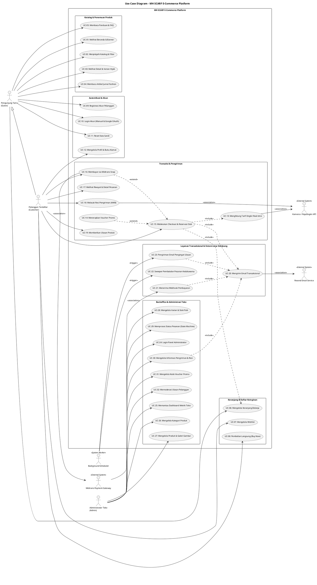
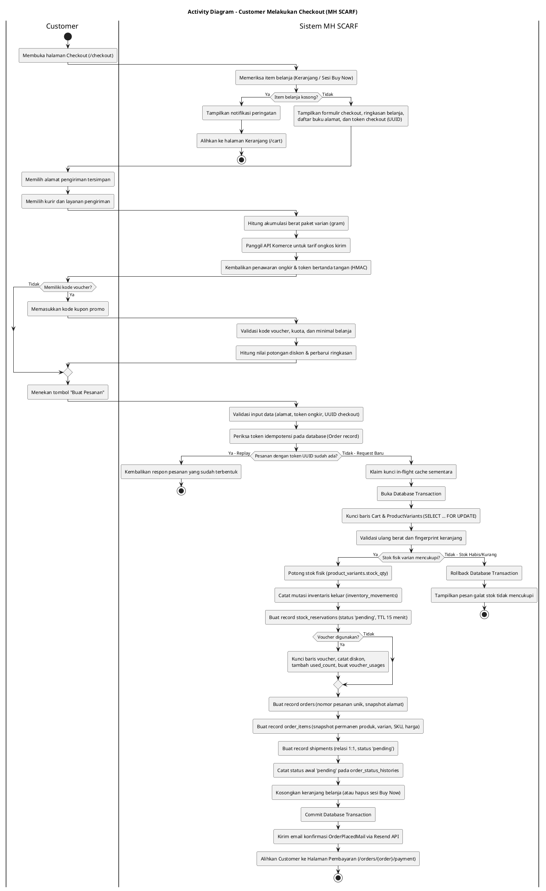
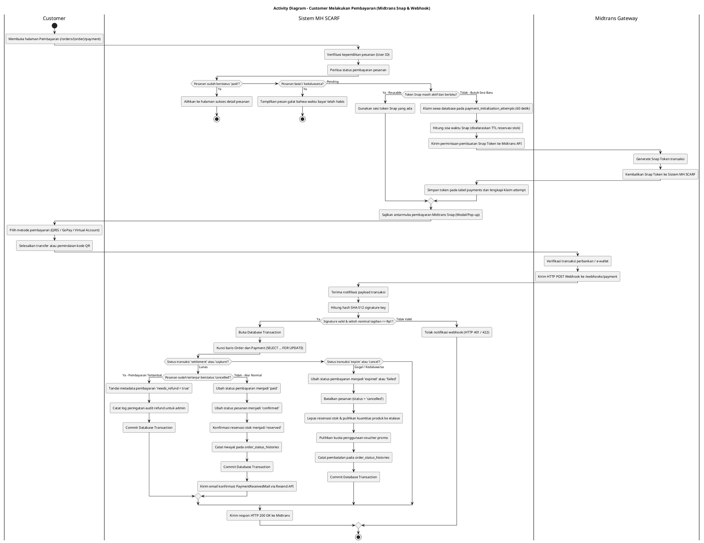
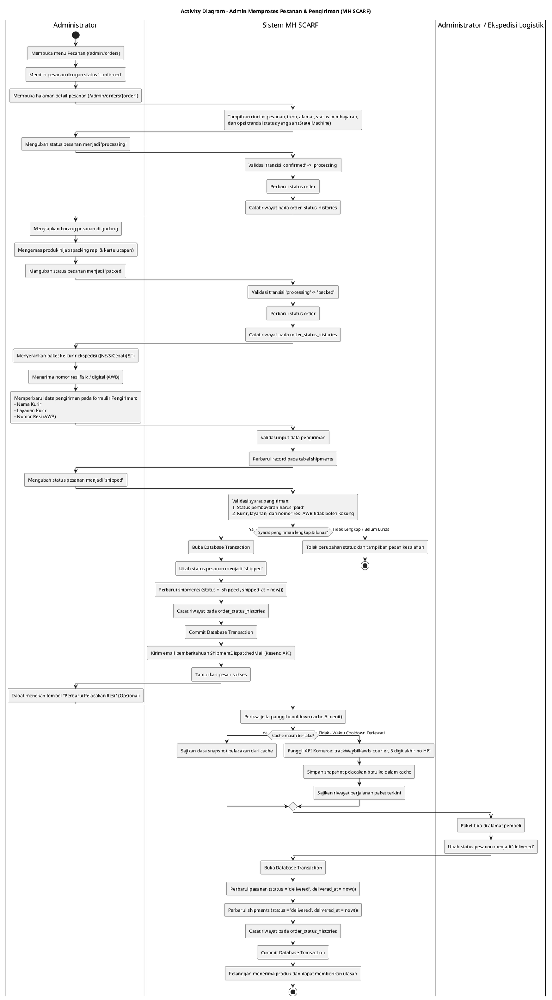
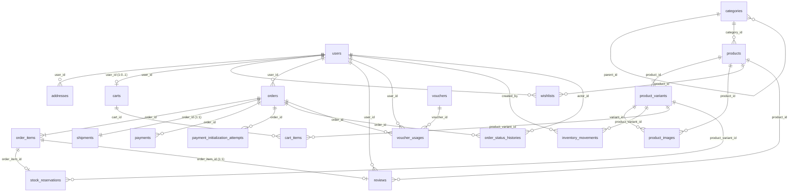
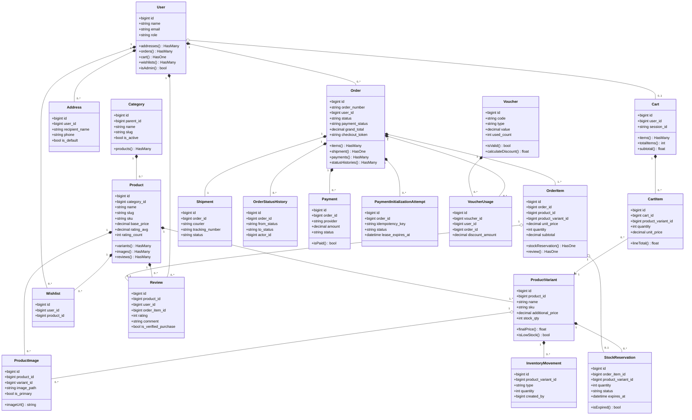
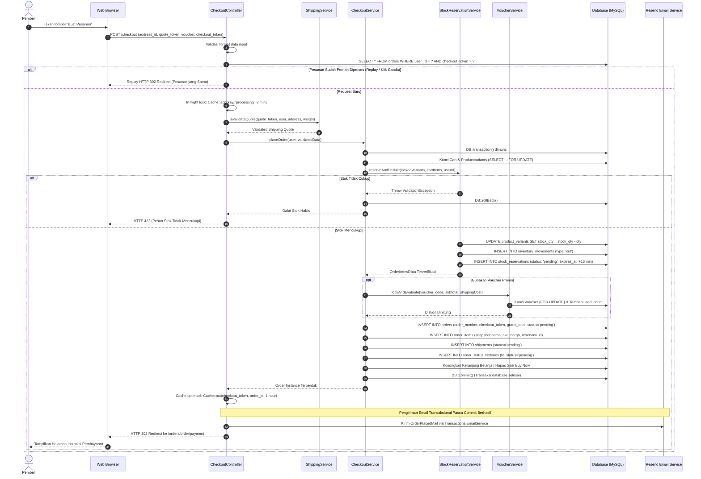
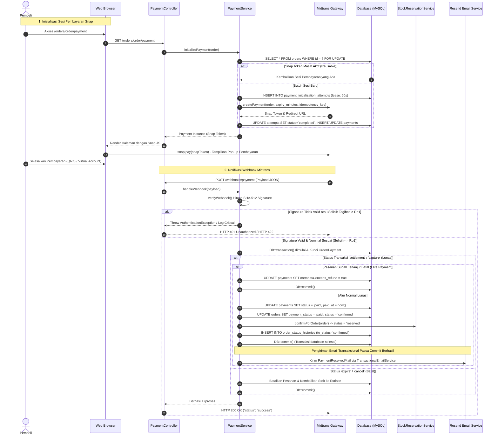

# Software Requirement Specification
## for
# MH SCARF E-Commerce Platform

---

### Dipersiapkan Oleh:

- <NIM - Nama Anggota 1>
- <NIM - Nama Anggota 2>
- <NIM - Nama Anggota 3>
- <NIM - Nama Anggota 4>
- <NIM - Nama Anggota 5>

**Program Studi Sistem Informasi**  
**Fakultas Ilmu Komputer**  
**Universitas Amikom Yogyakarta**  
**2026**

---

# DAFTAR ISI

- [HALAMAN JUDUL](#halaman-judul)
- [DAFTAR ISI](#daftar-isi)
- [DAFTAR TABEL](#daftar-tabel)
- [DAFTAR GAMBAR](#daftar-gambar)
- [RIWAYAT REVISI](#riwayat-revisi)
- [BAB 1. PENDAHULUAN](#bab-1-pendahuluan)
  - [1.1 Tujuan](#11-tujuan)
  - [1.2 Deskripsi Umum Dokumen](#12-deskripsi-umum-dokumen)
  - [1.3 Definisi dan Istilah](#13-definisi-dan-istilah)
  - [1.4 Referensi](#14-referensi)
- [BAB 2. DESKRIPSI PRODUK ATAU APLIKASI](#bab-2-deskripsi-produk-atau-aplikasi)
  - [2.1 Deskripsi Umum Produk atau Aplikasi](#21-deskripsi-umum-produk-atau-aplikasi)
  - [2.2 Kategori Pengguna Produk atau Aplikasi](#22-kategori-pengguna-produk-atau-aplikasi)
  - [2.3 Fitur Produk atau Aplikasi](#23-fitur-produk-atau-aplikasi)
  - [2.4 Karakteristik Pengguna Produk atau Aplikasi](#24-karakteristik-pengguna-produk-atau-aplikasi)
  - [2.5 Batasan Produk atau Aplikasi](#25-batasan-produk-atau-aplikasi)
  - [2.6 Dokumentasi Pengguna](#26-dokumentasi-pengguna)
- [BAB 3. KEBUTUHAN EKSTERNAL PRODUK ATAU APLIKASI](#bab-3-kebutuhan-eksternal-produk-atau-aplikasi)
  - [3.1 Karakteristik Tampilan Pengguna](#31-karakteristik-tampilan-pengguna)
  - [3.2 Karakteristik Hardware](#32-karakteristik-hardware)
  - [3.3 Karakteristik Software](#33-karakteristik-software)
  - [3.4 Karakteristik Komunikasi](#34-karakteristik-komunikasi)
- [BAB 4. KEBUTUHAN FUNGSIONAL PRODUK ATAU APLIKASI](#bab-4-kebutuhan-fungsional-produk-atau-aplikasi)
  - [4.1 Kebutuhan Fungsional](#41-kebutuhan-fungsional)
    - [4.1.1 Modul Autentikasi dan Akun Pengguna](#411-modul-autentikasi-dan-akun-pengguna)
    - [4.1.2 Modul Katalog, Produk, dan Informasi](#412-modul-katalog-produk-dan-informasi)
    - [4.1.3 Modul Keranjang Belanja dan Wishlist](#413-modul-keranjang-belanja-dan-wishlist)
    - [4.1.4 Modul Buku Alamat dan Ekspedisi](#414-modul-buku-alamat-dan-ekspedisi)
    - [4.1.5 Modul Checkout dan Pembuatan Pesanan](#415-modul-checkout-dan-pembuatan-pesanan)
    - [4.1.6 Modul Pembayaran Digital (Midtrans)](#416-modul-pembayaran-digital-midtrans)
    - [4.1.7 Modul Ulasan dan Rating Produk](#417-modul-ulasan-dan-rating-produk)
    - [4.1.8 Modul Panel Administrasi (Backoffice)](#418-modul-panel-administrasi-backoffice)
  - [4.2 Use Case Diagram](#42-use-case-diagram)
  - [4.3 Use Case Deskripsi](#43-use-case-deskripsi)
    - [4.3.1 Use Case Deskripsi Customer Melakukan Checkout](#431-use-case-deskripsi-customer-melakukan-checkout)
    - [4.3.2 Use Case Deskripsi Customer Melakukan Pembayaran](#432-use-case-deskripsi-customer-melakukan-pembayaran)
    - [4.3.3 Use Case Deskripsi Admin Memproses Pesanan dan Pengiriman](#433-use-case-deskripsi-admin-memproses-pesanan-dan-pengiriman)
    - [4.3.4 Use Case Deskripsi Admin Mengelola Produk Hijab](#434-use-case-deskripsi-admin-mengelola-produk-hijab)
  - [4.4 Activity Diagram](#44-activity-diagram)
    - [4.4.1 Activity Diagram Customer Melakukan Checkout](#441-activity-diagram-customer-melakukan-checkout)
    - [4.4.2 Activity Diagram Customer Melakukan Pembayaran](#442-activity-diagram-customer-melakukan-pembayaran)
    - [4.4.3 Activity Diagram Admin Memproses Pesanan dan Pengiriman](#443-activity-diagram-admin-memproses-pesanan-dan-pengiriman)
  - [4.5 Kebutuhan Database](#45-kebutuhan-database)
    - [4.5.1 Entity Relationship Diagram (ERD)](#451-entity-relationship-diagram-erd)
    - [4.5.2 Class Diagram](#452-class-diagram)
  - [4.6 Sequence Diagram](#46-sequence-diagram)
    - [4.6.1 Sequence Diagram Customer Checkout](#461-sequence-diagram-customer-checkout)
    - [4.6.2 Sequence Diagram Pembayaran Midtrans](#462-sequence-diagram-pembayaran-midtrans)
    - [4.6.3 Sequence Diagram Admin Memproses Pengiriman](#463-sequence-diagram-admin-memproses-pengiriman)

---

# DAFTAR TABEL

- **Tabel 1.** Riwayat Revisi Dokumen
- **Tabel 2.** Definisi dan Singkatan Istilah Teknis
- **Tabel 3.** Rincian Fitur Produk MH SCARF
- **Tabel 4.** Karakteristik Pengguna
- **Tabel 5.** Use Case Description - Customer Melakukan Checkout (UC-001)
- **Tabel 6.** Use Case Description - Customer Melakukan Pembayaran (UC-002)
- **Tabel 7.** Use Case Description - Admin Memproses Pesanan dan Pengiriman (UC-003)
- **Tabel 8.** Use Case Description - Admin Mengelola Produk Hijab (UC-004)
- **Tabel 9.** Kamus Entitas dan Relasi Basis Data MH SCARF

---

# DAFTAR GAMBAR

- **Gambar 1.** Diagram Arsitektur Aplikasi MH SCARF E-Commerce
- **Gambar 2.** Palet Identitas Visual Soft Luxury MH SCARF
- **Gambar 3.** Use Case Diagram Sistem MH SCARF E-Commerce (PlantUML)
- **Gambar 4.** Activity Diagram Customer Melakukan Checkout (PlantUML)
- **Gambar 5.** Activity Diagram Customer Melakukan Pembayaran Midtrans Snap (PlantUML)
- **Gambar 6.** Activity Diagram Admin Memproses Pesanan dan Pengiriman (PlantUML)
- **Gambar 7.** Entity Relationship Diagram (ERD) Sistem MH SCARF
- **Gambar 8.** Domain Class Diagram Sistem MH SCARF
- **Gambar 9.** Sequence Diagram Customer Melakukan Checkout
- **Gambar 10.** Sequence Diagram Pembayaran Midtrans Snap & Webhook
- **Gambar 11.** Sequence Diagram Admin Memproses Pengiriman dan Resi

---

# RIWAYAT REVISI

**Tabel 1. Riwayat Revisi Dokumen**

| Keterangan Revisi | Tanggal | Alasan Perubahan | Penanggungjawab Revisi |
|---|---|---|---|
| Revisi 1.0 (Dokumen Awal) | 27 Oktober 2026 | Penyusunan draf awal spesifikasi kebutuhan teknis sistem e-commerce internal tim pengembang. | Tim Pengembang MH SCARF |
| Revisi 2.0 (Restrukturisasi Amikom Bab 1–4) | 31 Oktober 2026 | Penyesuaian struktur dokumen mengikuti template resmi Universitas Amikom Yogyakarta Bab 1 sampai Bab 4. | Tim Analis Sistem & Dokumentasi Teknis |
| Revisi 2.1 (Audit Ulang, Presisi Teknis & Notasi UML) | 31 Oktober 2026 | Perbaikan formalitas bahasa akademis Bab 1, sinkronisasi fitur FAQ/Journal, penghapusan spesifikasi hardware tanpa dasar, penyesuaian notasi UML PlantUML murni, perbaikan urutan commit email dan parameter tracking, serta pembaruan kamus basis data. | Tim Analis Sistem & Dokumentasi Teknis |
| Revisi 2.1-Patch (Final Quality Correction) | 31 Oktober 2026 | Penyeragaman seluruh 26 Kebutuhan Fungsional (Precondition, Flow, Postcondition, Acceptance Criteria), koreksi redaksi FR-AUTH-004, penyelarasan 20 model Eloquent pada Class Diagram, dan penandaan status rendering PlantUML. | Tim Analis Sistem & Dokumentasi Teknis |

---

# BAB 1. PENDAHULUAN

## 1.1 Tujuan

Dokumen *Software Requirements Specification* (SRS) ini disusun untuk mendokumentasikan spesifikasi kebutuhan perangkat lunak sistem **MH SCARF E-Commerce Platform** secara formal, terstruktur, dan dapat diuji (*testable*). Dokumen ini berfungsi sebagai dokumen acuan dalam analisis, perancangan, pengembangan, dan pengujian sistem pada repositori proyek MH SCARF, yang memetakan kebutuhan bisnis butik busana muslimah dan hijab ke dalam bentuk kebutuhan fungsional dan arsitektur perangkat lunak berbasis Laravel 13.

Tujuan penyusunan dokumen SRS dirinci berdasarkan sudut pandang pemangku kepentingan (*stakeholders*):

1. **Bagi Pemilik Produk atau Stakeholder Bisnis (Owner):**  
   Menyediakan tolok ukur formal mengenai ruang lingkup aplikasi, aturan bisnis (*business rules*), serta perilaku transaksi otomatis (seperti pencegahan *overselling* melalui reservasi stok, integrasi pembayaran digital otomatis, dan kalkulasi ongkos kirim real-time) sehingga sistem yang dikembangkan selaras dengan tujuan penjualan *Direct-to-Consumer* (DTC).

2. **Bagi System Analyst:**  
   Menjadi instrumen teknis untuk memetakan alur bisnis ke dalam model konseptual, diagram Unified Modeling Language (UML), serta skema basis data relasional ternormalisasi yang konsisten dan bebas dari ambiguitas logika.

3. **Bagi Development Team (Software Engineers & Frontend Developers):**  
   Berfungsi sebagai pedoman teknis dalam mengimplementasikan pengendali (*controllers*), lapisan layanan (*service layer*), model Eloquent, antarmuka pengguna (*views* berbasis Blade dan Tailwind CSS), mekanisme proteksi konkurensi, dan penguncian transaksi basis data.

4. **Bagi Software Tester atau Tim Quality Assurance (QA):**  
   Menjadi landasan objektif dalam menyusun skenario pengujian fungsional (*functional test cases*), pengujian integrasi (*integration tests*), pengujian batas sistem (*boundary testing*), dan validasi kriteria penerimaan (*acceptance criteria*) dari setiap fitur yang dibangun.

5. **Bagi Pihak Akademis / Dosen Evaluator Universitas Amikom Yogyakarta:**  
   Menyediakan bukti formal penerapan prinsip-prinsip rekayasa perangkat lunak, ketepatan notasi diagram UML, integritas relasi basis data, dan kepatuhan terhadap standar pengembangan web modern pada Program Studi Sistem Informasi.

## 1.2 Deskripsi Umum Dokumen

Sistematika penyusunan dokumen SRS ini disusun berdasarkan template standar Universitas Amikom Yogyakarta yang difokuskan pada tahap analisis dan perancangan awal perangkat lunak, yang mencakup **BAB 1 sampai BAB 4**:

- **BAB 1. PENDAHULUAN:**  
  Menjelaskan tujuan penyusunan dokumen, sistematika dokumen, definisi dan singkatan istilah teknis yang digunakan, serta daftar referensi acuan.
- **BAB 2. DESKRIPSI PRODUK ATAU APLIKASI:**  
  Menjelaskan deskripsi umum sistem MH SCARF, kategori pengguna, tabel rincian fitur produk, tabel karakteristik pengguna, batasan operasional dan bisnis, serta ketersediaan dokumentasi pengguna.
- **BAB 3. KEBUTUHAN EKSTERNAL PRODUK ATAU APLIKASI:**  
  Menjelaskan karakteristik tampilan antarmuka visual pengguna (soft luxury tokens), kebutuhan perangkat keras (*hardware*) fungsional, kebutuhan perangkat lunak (*software stack*), serta karakteristik protokol dan keamanan komunikasi antar-subsistem.
- **BAB 4. KEBUTUHAN FUNGSIONAL PRODUK ATAU APLIKASI:**  
  Menjabarkan seluruh spesifikasi 26 kebutuhan fungsional secara granular per modul dengan kriteria penerimaan terukur, Use Case Diagram, Use Case Descriptions, Activity Diagrams, Entity Relationship Diagram (ERD), Domain Class Diagram, dan Sequence Diagrams.

## 1.3 Definisi dan Istilah

Guna memastikan keseragaman persepsi dan ketepatan teknis, istilah serta singkatan yang digunakan di dalam dokumen ini didefinisikan pada Tabel 2.

**Tabel 2. Definisi dan Singkatan Istilah Teknis**

| Istilah / Singkatan | Kepanjangan | Definisi |
|---|---|---|
| **SRS** | *Software Requirements Specification* | Dokumen spesifikasi kebutuhan perangkat lunak yang merinci fungsi, batasan, perilaku, dan karakteristik sistem secara formal. |
| **DTC** | *Direct-to-Consumer* | Model bisnis perdagangan di mana produsen atau pemilik merek menjual produk langsung kepada konsumen akhir tanpa perantara marketplace multi-vendor. |
| **SKU** | *Stock Keeping Unit* | Kode unik alfanumerik yang diberikan untuk setiap item atau varian produk spesifik guna identifikasi inventaris gudang. |
| **CRUD** | *Create, Read, Update, Delete* | Empat fungsi dasar manipulasi data persisten pada sistem basis data relasional. |
| **API** | *Application Programming Interface* | Kumpulan protokol dan antarmuka pemrograman yang memungkinkan komunikasi data antar-aplikasi perangkat lunak yang berbeda. |
| **OAuth** | *Open Authorization* | Standar protokol terbuka yang memungkinkan otorisasi akses akun pihak ketiga secara aman tanpa membagikan kata sandi (digunakan pada Google OAuth). |
| **ORM** | *Object-Relational Mapping* | Teknik pemrograman untuk memetakan tabel basis data relasional ke dalam objek perangkat lunak (diimplementasikan via Laravel Eloquent). |
| **MVC** | *Model-View-Controller* | Pola arsitektur perangkat lunak yang memisahkan logika data (Model), antarmuka pengguna (View), dan pengendali alur (Controller). |
| **HTTP / HTTPS** | *Hypertext Transfer Protocol (Secure)* | Protokol transfer komunikasi web; HTTPS menyediakan lapisan enkripsi data menggunakan TLS (*Transport Layer Security*). |
| **CSRF** | *Cross-Site Request Forgery* | Serangan siber yang memalsukan instruksi dari pengguna terautentikasi; dicegah melalui validasi token sesi Laravel pada setiap form POST. |
| **Midtrans Snap** | *Midtrans Snap Payment Interface* | Antarmuka pembayaran pihak ketiga yang menyediakan token modal/pop-up pembayaran yang mendukung QRIS, Virtual Account, dan E-Wallet. |
| **Komerce / RajaOngkir** | *Komerce Domestic Shipping API* | Layanan API pihak ketiga untuk menghitung tarif ongkos kirim domestik dan melacak status resi pengiriman kurir ekspedisi di Indonesia. |
| **AWB** | *Air Waybill* | Nomor resi bukti pengiriman barang yang diterbitkan oleh kurir ekspedisi logistik. |
| **Supabase Storage** | *Supabase Object Storage* | Layanan penyimpanan berkas media berbasis cloud yang kompatibel dengan protokol AWS S3 API. |
| **Resend** | *Resend Transactional Email API* | Layanan infrastruktur pengiriman email transaksional modern berbasis REST API. |
| **Idempotensi** | *Idempotence* | Karakteristik operasi perangkat lunak di mana request identik yang dieksekusi berulang kali tidak menyebabkan perubahan status tambahan atau duplikasi data. |
| **Reservasi Stok** | *Stock Reservation* | Mekanisme penahanan sementara kuantitas barang fisik dengan masa berlaku terbatas (15 menit) saat checkout agar tidak terjadi pembelian ganda (*overselling*). |
| **Webhook** | *HTTP Callback Notification* | Mekanisme pengiriman notifikasi asinkron berbasis HTTP POST dari sistem eksternal (Midtrans) ke server aplikasi saat peristiwa transaksi terjadi. |
| **Scheduler** | *Task Scheduling Engine* | Mekanisme penjadwalan eksekusi tugas periodik otomatis di latar belakang server (*cron job*) melalui Laravel Artisan Console. |
| **Bcrypt** | *Blowfish Cryptographic Hashing* | Fungsi hashing kata sandi adaptif satu arah berbasis algoritma Blowfish yang digunakan untuk mengamankan data kredensial pengguna. |
| **TTL** | *Time-to-Live* | Batas waktu kedaluwarsa suatu data atau sewa transaksi sebelum statusnya dianggap usang atau hangus oleh sistem. |

## 1.4 Referensi

Penyusunan dokumen dan perancangan sistem MH SCARF merujuk pada standar dan literatur teknis resmi berikut (format APA 7th Edition):

1. **Google Developers.** (n.d.). *Google Identity: OpenID Connect & OAuth 2.0 technical documentation*. Google. https://developers.google.com/identity/protocols/oauth2
2. **IEEE Computer Society.** (2018). *ISO/IEC/IEEE International Standard - Systems and software engineering — Life cycle processes — Requirements engineering* (ISO/IEC/IEEE Std 29148:2018). IEEE. https://doi.org/10.1109/IEEESTD.2018.8559686
3. **Komerce.** (n.d.). *Dokumentasi resmi RajaOngkir by Komerce API V2*. Komerce Teknologi Nusantara. https://rajaongkir.komerce.id
4. **Laravel LLC.** (n.d.). *Laravel framework 13.x official documentation*. Laravel. https://laravel.com/docs/13.x
5. **MH SCARF Engineering Team.** (2026a). *Product Requirement Document (PRD) — Website E-Commerce Hijab MH SCARF Store*. Dokumen Internal Proyek.
6. **MH SCARF Engineering Team.** (2026b). *Entity Relationship Diagram & Database Design (ERD-DATABASE.md)*. Dokumen Internal Proyek.
7. **MH SCARF Engineering Team.** (2026c). *MH SCARF Platform Repository Source Code (Laravel 13 / Tailwind CSS v4 / PHP 8.3)*. Dokumen Kode Sumber Repositori Proyek.
8. **PT Midtrans.** (n.d.). *Midtrans Snap & Core API technical documentation*. PT Midtrans. https://docs.midtrans.com
9. **Resend Inc.** (n.d.). *Resend Email API documentation & PHP SDK reference*. Resend. https://resend.com/docs
10. **Supabase Pte. Ltd.** (n.d.). *Supabase Storage S3-compatible API documentation*. Supabase. https://supabase.com/docs/guides/storage

---

# BAB 2. DESKRIPSI PRODUK ATAU APLIKASI

## 2.1 Deskripsi Umum Produk atau Aplikasi

### 2.1.1 Nama dan Jenis Aplikasi
Aplikasi ini bernama **MH SCARF E-Commerce Platform**, yakni perangkat lunak sistem informasi perdagangan elektronik (*e-commerce*) berbasis web monolitik modular (*modular monolith*) yang dibangun untuk memfasilitasi penjualan busana muslimah, hijab, dan aksesori penunjang secara *Direct-to-Consumer* (DTC).

### 2.1.2 Tujuan Pengembangan Aplikasi
Aplikasi ini dikembangkan untuk membangun saluran penjualan daring mandiri bagi butik MH SCARF. Melalui platform mandiri ini, interaksi katalog, kalkulasi tarif ekspedisi, verifikasi pembayaran digital, dan pemrosesan pesanan dapat berlangsung secara otomatis dan terpusat tanpa bergantung pada platform pihak ketiga.

### 2.1.3 Permasalahan Bisnis yang Diselesaikan
Berdasarkan dokumen Product Requirement Document (PRD) proyek, pengembangan sistem MH SCARF ditujukan untuk menjawab kebutuhan dan kendala operasional berikut:
1. **Ketergantungan terhadap Marketplace Pihak Ketiga:** Mengurangi beban potongan komisi transaksi yang tinggi serta persaingan harga pada marketplace umum melalui penyediaan saluran penjualan langsung (DTC).
2. **Kendala Verifikasi Pembayaran Manual:** Meniadakan proses konfirmasi pembayaran manual via chat WhatsApp atau pemeriksaan mutasi rekening manual melalui otomatisasi webhook payment gateway Midtrans.
3. **Pencegahan Masalah *Overselling*:** Mencegah terjadinya pembelian barang yang stok fisiknya telah habis melalui penerapan mekanisme penahanan stok sementara (*stock reservation*) selama 15 menit saat checkout.
4. **Kepastian Tarif Pengiriman Ekspedisi:** Menyediakan transparansi perhitungan ongkos kirim real-time hingga tingkat kecamatan di Indonesia menggunakan integrasi API Komerce/RajaOngkir V2.

### 2.1.4 Target Pengguna
Target pengguna sistem adalah konsumen pembeli produk hijab dan busana muslimah di Indonesia yang mengakses situs belanja melalui peramban web pada ponsel pintar maupun komputer. Profil pengguna konseptual yang dirumuskan pada dokumen PRD mencakup kalangan mahasiswi, profesional muda, dan ibu muda yang mengutamakan kepastian warna varian, kenyamanan bahan, dan kemudahan pembayaran digital. Di sisi operasional, aplikasi digunakan oleh administrator toko untuk pengelolaan inventaris dan pemrosesan pesanan.

### 2.1.5 Ruang Lingkup Sistem
Ruang lingkup sistem dibagi menjadi dua area fungsional:
1. **Storefront Pelanggan (Customer Area & Publik):**
   - Penjelajahan beranda dan informasi koleksi busana muslim.
   - Penelusuran katalog hijab dengan pencarian kata kunci, filter kategori, penanda diskon, dan pengurutan harga.
   - Penayangan detail produk, varian multi-warna dan ukuran, instruksi perawatan bahan, serta ulasan pembeli terverifikasi.
   - Pembelian langsung tanpa keranjang (*Buy Now*) dan pengelolaan keranjang belanja multi-item.
   - Pengelolaan daftar keinginan (*Wishlist*).
   - Pengelolaan buku alamat pengiriman multi-entri.
   - Proses checkout terproteksi dengan kalkulasi ongkos kirim real-time dan input kode voucher promo.
   - Pembayaran digital terintegrasi melalui antarmuka modal Midtrans Snap.
   - Pemantauan riwayat status pesanan dan pelacakan resi ekspedisi (AWB).
   - Penayangan halaman panduan/FAQ dan artikel jurnal edukatif busana muslim.
   - Pemberian ulasan rating bintang (1–5) dan komentar teks pada pesanan yang telah tiba.
2. **Backoffice Administrator (Panel Toko):**
   - Monitoring dashboard metrik operasional (omzet terbayar, antrean pesanan butuh proses, peringatan stok menipis, review tertunda).
   - Manajemen kategori produk hijab (CRUD, slug URL otomatis, unggah gambar kategori ke Supabase Storage).
   - Manajemen produk hijab (CRUD, kode SKU unik, harga dasar, diskon coret, status unggulan/best seller).
   - Manajemen varian produk (warna, kode hex, ukuran, kuantitas stok fisik gudang, berat gram paket).
   - Manajemen galeri gambar produk di Supabase Storage dengan penetapan foto utama (*primary*).
   - Pemrosesan status pesanan mengikuti aturan mesin status (*state machine*).
   - Manajemen pengiriman dan input nomor resi pengiriman kurir (AWB).
   - Pengelolaan kode voucher promosi (persentase, potongan nominal, gratis ongkir, batas kuota pemakaian).
   - Moderasi publikasi ulasan pelanggan sebelum ditampilkan ke katalog publik.

### 2.1.6 Gambaran Proses Bisnis Utama
Alur bisnis utama MH SCARF dirancang terstruktur sebagai berikut:
1. Pengguna memilih varian produk & kuantitas &rarr; menambahkan ke keranjang belanja atau menekan Beli Sekarang.
2. Pengguna login ke akun terdaftar &rarr; memilih alamat pengiriman &rarr; sistem menghitung ongkos kirim real-time &rarr; pengguna memasukkan kupon promo jika ada.
3. Pengguna menekan tombol "Buat Pesanan" &rarr; sistem secara atomik mengunci baris data di database, memotong stok fisik varian, mencatat mutasi keluar, menerbitkan reservasi stok 15 menit, mencatat pesanan berstatus `pending`, dan menerbitkan token idempotensi.
4. Pengguna menyelesaikan pembayaran pada pop-up Midtrans Snap &rarr; Midtrans mengirimkan notifikasi HTTP POST webhook ke server MH SCARF &rarr; signature SHA-512 diverifikasi &rarr; pesanan beralih ke status `confirmed`, status pembayaran menjadi `paid`, reservasi stok beralih menjadi `reserved`, dan email konfirmasi pembayaran dikirim otomatis ke pelanggan.
5. Admin menyiapkan barang di gudang (`confirmed` &rarr; `processing` &rarr; `packed`) &rarr; paket diserahkan ke kurir &rarr; admin memasukkan nomor resi AWB &rarr; status pesanan beralih ke `shipped` &rarr; email notifikasi pengiriman berisi nomor resi dikirim ke pembeli.
6. Paket tiba di tujuan &rarr; status berubah menjadi `delivered` &rarr; status selesai (`completed`) &rarr; pelanggan dapat memberikan rating dan ulasan teks.
7. Jika pembayaran tidak diverifikasi dalam 15 menit, sistem sweeper otomatis (`orders:release-expired`) membatalkan pesanan kedaluwarsa dan mengembalikan stok fisik varian ke etalase toko.

### 2.1.7 Gambaran Arsitektur Aplikasi dan Teknologi Aktual
Aplikasi MH SCARF mengadopsi pola arsitektur *Modular Monolith* menggunakan framework Laravel 13, dengan pemisahan tanggung jawab berbasis Controller, Service, dan Model Eloquent.

Hubungan arsitektural antara antarmuka pengguna, logika server, basis data, dan layanan pihak ketiga diilustrasikan pada Gambar 1.

```
+-----------------------------------------------------------------------------------+
|                            STOREFRONT & ADMIN CLIENT                              |
|          (Responsive Web: Tailwind CSS v4, Blade Templates, Vite 8, DM Sans)      |
+-----------------------------------------------------------------------------------+
                                         | HTTPS (JSON / Form POST / CSRF Token)
                                         v
+-----------------------------------------------------------------------------------+
|                       APLIKASI WEB LARAVEL 13.x (PHP 8.3+)                        |
|  - Routing & Middleware (Auth, EnsureUserIsAdmin, Throttle, EncryptCookies)       |
|  - Controller Layer (Catalog, Cart, Checkout, Order, Payment, Admin Controllers)  |
|  - Service Layer (CheckoutService, StockReservationService, PaymentService, dll)  |
|  - Domain Model Layer (Eloquent ORM, Multi-Attribute Casting, Model Observers)    |
|  - Background Tasks (Artisan Scheduler: orders:release-expired, reviews:remind)   |
+-----------------------------------------------------------------------------------+
        |                      |                    |                  |
        v                      v                    v                  v
+---------------+      +----------------+   +---------------+   +-------------------+
|  CLEVER CLOUD |      | SUPABASE S3    |   | MIDTRANS SNAP |   | KOMERCE / RESEND  |
|  MySQL DB     |      | Storage Bucket |   | Payment GW    |   | Ekspedisi & Email |
+---------------+      +----------------+   +---------------+   +-------------------+
```
**Gambar 1. Diagram Arsitektur Aplikasi MH SCARF E-Commerce**

Komponen teknologi utama yang digunakan sesuai implementasi basis kode aktual:
- **Bahasa Pemrograman & Runtime:** PHP versi 8.3 ke atas.
- **Framework Backend:** Laravel Framework versi 13.17 (`laravel/framework: ^13.17`).
- **Antarmuka & Styling:** Laravel Blade Templates, Tailwind CSS versi 4.0 (`@tailwindcss/vite: ^4.0.0`), Vite 8.
- **Basis Data:** MySQL 8.x pada lingkungan Clever Cloud / SQLite 3 in-memory untuk automated testing.
- **Penyimpanan Berkas Objek:** Supabase Storage (kompatibel AWS S3 API via `league/flysystem-aws-s3-v3: ^3.35`).
- **Gateway Pembayaran:** Midtrans Snap & Core API (`midtrans/midtrans-php: ^2.6`).
- **Tarif & Pelacakan Ekspedisi:** Komerce / RajaOngkir Domestic Destination & Cost API V2.
- **Infrastruktur Email Transaksional:** Resend API (`resend/resend-php: ^1.17`).
- **Autentikasi Pihak Ketiga:** Laravel Socialite Google OAuth 2.0 (`laravel/socialite: ^5.31`).

---

## 2.2 Kategori Pengguna Produk atau Aplikasi

Berdasarkan struktur kontrol akses dan middleware pada basis kode, sistem MH SCARF membagi pengguna ke dalam tiga kategori aktor:

1. **Pengunjung Tamu (Guest):**  
   Pengguna yang mengakses aplikasi web tanpa melakukan autentikasi login. Tamu memiliki hak akses publik untuk menjelajahi etalase katalog, melihat detail varian produk, membaca panduan FAQ, membaca artikel jurnal fashion, dan mengelola keranjang belanja sementara berbasis sesi cookie peramban (`session_id`). Tamu diarahkan untuk melakukan registrasi atau login saat hendak memfinalisasi pesanan ke tahap checkout.

2. **Pelanggan Terdaftar (Customer):**  
   Pengguna yang telah memiliki akun terautentikasi dengan atribut basis data `role = 'customer'` (baik terdaftar melalui form email-password manual maupun Google OAuth). Pelanggan memiliki hak akses terhadap fitur transaksi personal, pengelolaan buku alamat, keranjang belanja akun, checkout, pembayaran digital, pelacakan pesanan, dan penulisan ulasan produk. Pelanggan **tidak memiliki hak akses administratif apapun**.

3. **Administrator Toko (Admin):**  
   Pengguna internal yang memiliki akun dengan atribut basis data `role = 'admin'`. Akses admin diproteksi oleh middleware khusus (`admin` / `EnsureUserIsAdmin`) dan pintu gerbang login tersendiri (`/admin/login`). Pemilik butik (*owner*) menjalankan operasional harian toko menggunakan akun dengan role `admin` ini. Administrator memiliki wewenang mengelola katalog produk, stok gudang, pemrosesan pesanan, input nomor resi AWB, pengaturan kupon voucher promo, dan moderasi ulasan pembeli. Akun dengan role admin secara mutlak dicegah melakukan login melalui pintu Google OAuth pelanggan.

---

## 2.3 Fitur Produk atau Aplikasi

Rincian fitur produk yang tersedia pada sistem MH SCARF disajikan pada Tabel 3, yang dikelompokkan berdasarkan kategori pengguna dan telah diverifikasi terhadap kode sumber aktual.

**Tabel 3. Rincian Fitur Produk MH SCARF**

| Kategori Pengguna | ID Fitur | Fitur | Deskripsi Singkat |
|---|---|---|---|
| **Guest** | `MHSC-001` | Penjelajahan Beranda & Katalog | Melihat halaman beranda, banner promosi statis, dan katalog produk hijab dengan penomoran halaman (paginasi). |
| **Guest** | `MHSC-002` | Pencarian & Filter Produk | Mencari produk hijab berdasarkan kata kunci nama, deskripsi, bahan, filter kategori, diskon, dan urutan harga. |
| **Guest** | `MHSC-003` | Penayangan Detail & Varian | Menampilkan rincian spesifikasi produk, varian warna/ukuran, stok riil, ulasan terverifikasi, dan produk terkait. |
| **Guest** | `MHSC-004` | Pengelolaan Keranjang Tamu | Menambahkan item ke keranjang belanja sementara yang diikat pada sesi peramban pengguna tanpa harus login terlebih dahulu. |
| **Guest** | `MHSC-005` | Registrasi Akun Manual | Melakukan pendaftaran akun pelanggan baru menggunakan nama, email unik, nomor telepon, dan kata sandi aman. |
| **Guest** | `MHSC-006` | Login Akun Manual | Masuk ke akun pelanggan terdaftar menggunakan email dan kata sandi dengan proteksi pembatasan laju (*rate limiting*). |
| **Guest** | `MHSC-007` | Login Google OAuth | Masuk atau mendaftar secara instan menggunakan akun Google resmi pelanggan melalui protokol OAuth 2.0 (Socialite). |
| **Guest** | `MHSC-008` | Permintaan Reset Kata Sandi | Mengajukan tautan pemulihan kata sandi melalui pengiriman email token berbatas waktu ke alamat email terdaftar. |
| **Guest** | `MHSC-029` | Penayangan Panduan & FAQ | Mengakses halaman tanya jawab informasi tata cara belanja, kebijakan pengiriman, dan metode pembayaran pada rute `/faq`. |
| **Guest** | `MHSC-030` | Penayangan Artikel Jurnal Fashion | Membaca artikel edukatif seputar karakteristik bahan hijab dan panduan perawatan busana muslim pada rute `/journal/{slug}`. |
| **Customer** | `MHSC-009` | Penggabungan Keranjang Otomatis | Menggabungkan item keranjang belanja sesi tamu secara otomatis ke keranjang akun pelanggan saat berhasil login. |
| **Customer** | `MHSC-010` | Pembelian Langsung (*Buy Now*) | Melewati alur keranjang belanja dan langsung mengalihkan pengguna ke formulir checkout untuk varian terpilih. |
| **Customer** | `MHSC-011` | Pengelolaan Daftar Keinginan | Menyimpan dan menghapus produk hijab favorit ke dalam daftar wishlist pribadi. |
| **Customer** | `MHSC-012` | Pengelolaan Buku Alamat | Menambah, mengubah, menghapus, dan menetapkan satu alamat pengiriman utama (*default address*). |
| **Customer** | `MHSC-013` | Perhitungan Ongkir Real-time | Menghitung tarif ongkos kirim resmi kurir domestik berdasarkan berat paket dan kecamatan tujuan via Komerce API. |
| **Customer** | `MHSC-014` | Penggunaan Voucher Promo | Mengaplikasikan kupon voucher diskon (persentase, potongan harga, atau gratis ongkir) pada formulir checkout. |
| **Customer** | `MHSC-015` | Checkout Idempotent & Reservasi | Membuat pesanan belanja dengan token idempotensi UUID dan mereservasi stok produk secara atomik selama 15 menit. |
| **Customer** | `MHSC-016` | Pembayaran Midtrans Snap | Membayar tagihan belanja melalui pop-up Midtrans Snap yang mendukung QRIS, Virtual Account bank, dan E-Wallet. |
| **Customer** | `MHSC-017` | Riwayat & Pembatalan Pesanan | Melihat daftar riwayat pesanan serta membatalkan pesanan mandiri selama status pesanan masih berstatus `pending`. |
| **Customer** | `MHSC-018` | Pelacakan Pengiriman (Tracking) | Melihat riwayat manifest status perjalanan paket ekspedisi berdasarkan nomor resi AWB (dengan cooldown cache 5 menit). |
| **Customer** | `MHSC-019` | Pemberian Ulasan Produk | Memberikan rating bintang (1–5) dan komentar ulasan teks pada barang belanjaan yang telah tiba (*delivered*/*completed*). *(Catatan: Input berkas foto ulasan berstatus Partially Implemented)*. |
| **Admin** | `MHSC-020` | Autentikasi Panel Administrator | Masuk ke antarmuka operasional khusus `/admin/login` dengan validasi otorisasi peran (*role verification*). |
| **Admin** | `MHSC-021` | Monitoring Dashboard Metrik | Memantau ringkasan omzet pembayaran sah, jumlah antrean pesanan, peringatan stok menipis, dan review pending. |
| **Admin** | `MHSC-022` | Manajemen Kategori Hijab | Melakukan operasi CRUD kategori hijab, pembuatan slug URL otomatis, dan upload gambar kategori ke Supabase Storage. |
| **Admin** | `MHSC-023` | Manajemen Produk & Galeri Foto | Melakukan operasi CRUD produk, penentuan harga dasar, diskon coret, atribut bahan, dan pengelolaan galeri foto. |
| **Admin** | `MHSC-024` | Manajemen Varian & Stok Fisik | Menambah dan mengubah varian multi-warna/ukuran, kode hex, berat gram paket, dan penyesuaian kuantitas stok gudang. |
| **Admin** | `MHSC-025` | Pemrosesan Status Pesanan | Mengubah status pesanan sesuai mesin status (*pending* &rarr; *confirmed* &rarr; *processing* &rarr; *packed* &rarr; *shipped* &rarr; *delivered*). |
| **Admin** | `MHSC-026` | Manajemen Pengiriman & Resi | Memasukkan nama kurir ekspedisi, nama layanan, dan nomor resi AWB sebelum pesanan ditandai sebagai dikirim (*shipped*). |
| **Admin** | `MHSC-027` | Manajemen Voucher Promo | Membuat, mengedit, mengaktifkan/menonaktifkan, dan menghapus kode voucher promosi beserta batas pemakaian. |
| **Admin** | `MHSC-028` | Moderasi Ulasan Pelanggan | Meninjau dan mengubah status publikasi ulasan pelanggan (*published* / *hidden*) pada etalase toko. |

*Catatan Fitur Non-Aktif (Planned):* Fitur pengelolaan banner dinamis (`banners`), kotak masuk notifikasi in-app (`notifications`), pencatatan log kunjungan produk (`product_views`), dan ekspor berkas laporan keuangan (PDF/Excel) berstatus direncanakan (*Planned*) dan tidak dimasukkan ke dalam daftar fitur aktif di atas.

---

## 2.4 Karakteristik Pengguna Produk atau Aplikasi

Tugas, hak akses ke aplikasi, dan kualifikasi kemampuan yang harus dimiliki oleh setiap kategori pengguna disajikan pada Tabel 4.

**Tabel 4. Karakteristik Pengguna**

| Kategori Pengguna | Tugas | Hak Akses ke Aplikasi | Kemampuan yang Harus Dimiliki |
|---|---|---|---|
| **Pengunjung Tamu (Guest)** | Menjelajahi koleksi hijab, membandingkan varian warna dan bahan, mengelola keranjang belanja sementara, membaca FAQ dan jurnal, serta melakukan registrasi atau login akun. | Hak akses publik tanpa otentikasi (melihat beranda, katalog, detail produk, FAQ, jurnal, keranjang belanja tamu, form registrasi, form login). | Mampu mengoperasikan peramban web pada ponsel pintar atau komputer serta memahami alur belanja online mendasar. |
| **Pelanggan Terdaftar (Customer)** | Mengelola data profil, buku alamat pengiriman, keranjang belanja akun, melakukan checkout, membayar tagihan digital, memantau pengiriman, dan memberikan ulasan produk. | Hak akses personal setelah terautentikasi (akses rute `/profile`, `/addresses`, `/checkout`, `/orders`, `/wishlist`, `/reviews`). Tidak memiliki akses ke `/admin`. | Mampu mengoperasikan aplikasi web, mengisi formulir digital, memahami tata cara pembayaran uang elektronik (QRIS/VA), dan mengelola email. |
| **Administrator Toko (Admin)** | Mengelola operasional toko harian, inventaris stok gudang, pembaruan katalog dan foto, pemrosesan status pesanan, pencatatan nomor resi AWB, dan pengaturan voucher promo. | Hak akses penuh administratif ke seluruh modul di bawah rute `/admin/*` setelah diverifikasi oleh middleware `EnsureUserIsAdmin`. | Memahami alur pemenuhan pesanan ritel busana muslim, ekspedisi logistik, pengelolaan stok fisik gudang, dan operasional aplikasi komputer perkantoran. |

---

## 2.5 Batasan Produk atau Aplikasi

Batasan operasional, bisnis, dan teknologi yang mengikat sistem MH SCARF diuraikan sebagai berikut:

### 2.5.1 Batasan Ruang Lingkup Bisnis
1. **Model Bisnis Direct-to-Consumer:** Sistem dikhususkan secara eksklusif untuk butik busana muslimah MH SCARF dan tidak mendukung model multi-vendor (*marketplace*) di mana pihak luar dapat membuka toko mandiri.
2. **Wilayah Layanan Pengiriman Domestik:** Sistem hanya melayani transaksi pengiriman paket ekspedisi logistik di dalam wilayah hukum Negara Kesatuan Republik Indonesia. Pengiriman internasional tidak didukung.
3. **Mata Uang Tunggal Rupiah (IDR):** Seluruh kalkulasi harga produk, diskon, biaya pengiriman, dan tagihan pembayaran hanya menggunakan mata uang Rupiah Indonesia (IDR) bulat tanpa komponen nilai desimal/sen.

### 2.5.2 Batasan Fungsional dan Operasional
1. **Batas Masa Berlaku Reservasi Stok:** Stok barang fisik yang dipotong saat pembuatan pesanan hanya ditahan selama 15 menit (*time-to-live*). Apabila pembayaran tidak terverifikasi dalam rentang waktu tersebut, pesanan otomatis kedaluwarsa dan stok dikembalikan ke etalase toko.
2. **Aturan Transisi Pembatalan Pesanan:** Pembatalan pesanan secara mandiri oleh pelanggan hanya diperbolehkan selama pesanan masih berstatus `pending`. Pesanan yang telah berstatus `shipped` tidak dapat dibatalkan oleh pihak manapun melalui alur sistem.
3. **Syarat Pengiriman dan Resi:** Admin hanya diizinkan mengubah status pesanan menjadi `shipped` apabila status pembayaran telah lunas (`paid`) serta nama kurir, layanan, dan nomor resi AWB telah terisi lengkap.
4. **Syarat Pemberian Ulasan:** Pelanggan hanya berhak memberikan ulasan pada produk yang telah dibeli secara sah (*verified purchase*) dan pesanan telah mencapai status tiba (`delivered`) atau selesai (`completed`).

### 2.5.3 Batasan Teknologi dan Arsitektur
1. **Platform Berbasis Web Responsif:** Aplikasi dibangun sebagai situs web berbasis peramban (*web-based*) dan tidak disediakan dalam bentuk aplikasi mobile native terinstalasi (seperti berkas Android APK atau iOS IPA).
2. **Karakteristik Penguncian Transaksi:** Pada lingkungan eksekusi serverless yang bersifat *stateless* (dengan konfigurasi `CACHE_STORE=array`), seluruh penguncian transaksi kritis (stok, token checkout, dan klaim pembayaran) dikelola melalui transaksi baris basis data relasional (`lockForUpdate()`) dan tabel sewa persisten.
3. **Kompatibilitas Peramban Klien:** Pengguna diwajibkan memiliki koneksi internet aktif dan menggunakan peramban web modern yang mendukung standar JavaScript ES6 dan CSS modern.

### 2.5.4 Batasan Ketergantungan Layanan Pihak Ketiga
1. **Gateway Pembayaran Midtrans:** Ketersediaan channel pembayaran digital bergantung pada operasional server Midtrans Snap Sandbox/Production.
2. **API Ekspedisi Komerce / RajaOngkir:** Keakuratan tarif ongkir dan pelacakan status resi AWB bergantung pada layanan Komerce API V2. Sistem menerapkan batas jeda panggil (*cache cooldown* 5 menit) untuk melindungi kuota API.
3. **Penyimpanan Media Supabase Storage:** Gambar produk disimpan pada bucket cloud Supabase Storage di wilayah `ap-southeast-1` dan diakses melalui protokol publik HTTPS AWS S3 API.
4. **Email Transaksional Resend:** Pengiriman email bukti pemesanan dan pelunasan bergantung pada kuota dan performa layanan Resend REST API.

---

## 2.6 Dokumentasi Pengguna

Ketersediaan dokumentasi panduan pengguna diklasifikasikan menjadi dokumentasi yang telah tersedia secara langsung dalam aplikasi dan dokumentasi yang direncanakan:

### 2.6.1 Dokumentasi yang Telah Disediakan dalam Aplikasi
1. **Halaman FAQ Publik (`/faq`):** Menyajikan panduan tanya jawab seputar tata cara belanja, estimasi waktu pengiriman, metode pembayaran yang didukung, dan kebijakan retur produk.
2. **Artikel Jurnal & Panduan Busana (`/journal/{slug}`):** Menyajikan artikel edukatif seputar karakteristik material bahan hijab (Voal, Silk, Satin, Ceruty) dan instruksi perawatan busana muslim (*care instructions*).
3. **Instruksi Pembayaran Interaktif (`/orders/{order}/payment`):** Menyajikan panduan langkah demi langkah cara transfer Virtual Account dan pemindaian kode QRIS saat pop-up Midtrans Snap ditampilkan.

### 2.6.2 Dokumentasi yang Direncanakan Saat Serah Terima Sistem
1. **Buku Panduan Pelanggan (*Customer User Guide* - PDF):** Dokumen panduan visual yang mengilustrasikan alur pendaftaran akun, penambahan alamat multi-kota, penggunaan kupon voucher promo, dan pelacakan paket pesanan.
2. **Buku Manual Administrator (*Backoffice Administrator Manual* - PDF):** Dokumen petunjuk teknis operasional bagi admin toko yang mencakup prosedur manajemen katalog hijab, tata kelola stok gudang, alur pemrosesan pesanan berbasis *state machine*, pengemasan paket, dan penginputan nomor resi pengiriman AWB.

---

# BAB 3. KEBUTUHAN EKSTERNAL PRODUK ATAU APLIKASI

## 3.1 Karakteristik Tampilan Pengguna

### 3.1.1 Platform Tampilan
Antarmuka pengguna MH SCARF dirancang dengan pendekatan *mobile-first responsive design* yang mampu menyesuaikan tata letak pada berbagai ukuran layar peramban:
- **Tampilan Ponsel Pintar (*Mobile*):** Mengoptimalkan navigasi sentuh, menu hamburger responsif, komponen filter katalog berbasis *bottom sheet*, dan tata letak kartu produk satu atau dua kolom.
- **Tampilan Tablet & Desktop:** Menyajikan navigasi horizontal penuh, panel filter katalog di sisi samping (*sidebar filter*), serta dashboard operasional backoffice dengan tabel data lebar.

### 3.1.2 Identitas Visual (Soft Luxury Brand Tokens)
Sesuai konsep merek butik hijab, antarmuka storefront menerapkan identitas visual *Soft Luxury Feminine* yang anggun, tenang, dan bersih. Palet warna dan tipografi sistem didefinisikan secara presisi pada variabel CSS (`resources/css/app.css`):

- **Ivory / Cream (`#FFF9F5`):** Warna latar belakang utama situs yang memberikan kesan hangat dan bersih.
- **Dusty Rose (`#D98FAF`):** Warna aksen feminin utama untuk tombol aksi, badge penawaran, dan elemen interaktif.
- **Mauve (`#B97897`):** Warna turunan untuk status hover, border lembut, dan penekanan visual sekunder.
- **Soft Gold (`#C9A227`):** Warna aksen mewah untuk ikon bintang rating, badge *Best Seller*, dan ornamen khusus.
- **Charcoal Ink (`#3A3033`):** Warna tipografi utama yang kontras dan nyaman dibaca (bukan hitam pekat).
- **Tipografi Utama:** Keluarga font sans-serif modern **DM Sans** untuk judul (*headline*) dan teks isi (*body text*).

```
+---------------------------------------------------------------------------------+
|                       PALET WARNA BRAND MH SCARF                                |
|  [ Ivory #FFF9F5 ]      [ Dusty Rose #D98FAF ]      [ Mauve #B97897 ]           |
|  [ Soft Gold #C9A227 ]  [ Charcoal #3A3033 ]        [ Surface #FCF7F8 ]         |
+---------------------------------------------------------------------------------+
```
**Gambar 2. Palet Identitas Visual Soft Luxury MH SCARF**

Untuk panel administrator (`/admin`), sistem menggunakan palet warna korporat yang fungsional dan terpisah dari storefront: latar belakang Slate (`#F5F7FA`), permukaan putih (`#FFFFFF`), teks gelap (`#172033`), aksen biru administratif (`#2563EB`), serta badge status standar (Hijau `#15803D`, Kuning `#B45309`, Merah `#B42318`).

### 3.1.3 Komponen Antarmuka Pengguna
Komponen antarmuka yang terverifikasi diimplementasikan pada basis kode:
1. **Top Navigation Bar:** Berisi logo butik MH SCARF, tautan navigasi (Beranda, Katalog, Jurnal, FAQ), tombol pencarian, ikon keranjang belanja dengan indikator jumlah barang, serta menu dropdown akun pengguna.
2. **Product Card Component:** Menampilkan gambar utama varian, badge diskon/best seller, nama produk, kategori, harga jual (disertai harga coret jika promo), dan tombol aksi cepat.
3. **Filter & Sort Sheet:** Komponen penyaring kategori dan pengurutan harga yang adaptif (berupa panel sidebar di desktop dan *bottom-sheet modal* di mobile).
4. **Checkout Form Component:** Formulir modular dengan pemilihan alamat radio card, dropdown kurir dinamis, input kode voucher dengan pratinjau kalkulasi seketika, dan rincian ringkasan biaya.
5. **Floating Toast Notification:** Komponen notifikasi mengambang di bagian atas layar untuk memberikan umpan balik sukses (*success toast*) atau kesalahan (*error toast*) pasca aksi pengguna.

### 3.1.4 Karakteristik Interaksi
- **Umpan Balik Visual Cepat:** Setiap penambahan barang ke keranjang atau toggle wishlist memberikan indikasi visual langsung tanpa memuat ulang seluruh halaman.
- **Validasi Input Real-time:** Formulir checkout dan alamat menampilkan pesan galat validasi di bawah kolom input jika data tidak lengkap.
- **Pencegahan Klik Ganda (*Debounce & Disabled State*):** Tombol "Buat Pesanan" dan tombol pembayaran otomatis dinonaktifkan (*disabled*) seketika setelah ditekan pertama kali untuk mencegah pengiriman request ganda.

---

## 3.2 Karakteristik Hardware

Sebagai aplikasi web modern berbasis cloud, sistem MH SCARF dapat diakses menggunakan perangkat keras umum yang mendukung peramban web modern tanpa memerlukan spesifikasi komputasi khusus di sisi klien.

### 3.2.1 Hardware Pengguna (Storefront Customer)
- **Kategori Perangkat:** Ponsel pintar (*smartphone*), tablet, laptop, atau komputer personal desktop.
- **Perangkat Masukan:** Layar sentuh (*touchscreen*) atau mouse dan keyboard standar.
- **Konektivitas Jaringan:** Koneksi internet aktif (jaringan seluler atau Wi-Fi) yang mampu memuat halaman web dan aset gambar.
- **Rekomendasi Layar:** Perangkat dengan lebar layar 360 piksel ke atas disarankan untuk kenyamanan tata letak antarmuka mobile.

### 3.2.2 Hardware Administrator (Backoffice)
- **Kategori Perangkat:** Laptop atau komputer desktop personal.
- **Perangkat Masukan:** Keyboard fisik dan mouse/trackpad.
- **Konektivitas Jaringan:** Koneksi internet broadband stabil untuk pengunggahan berkas foto resolusi tinggi ke Supabase Storage.
- **Rekomendasi Layar:** Resolusi layar 1366 &times; 768 piksel ke atas disarankan untuk visibilitas tabel data operasional dan dashboard.

### 3.2.3 Hardware Lingkungan Server (Serverless & Managed Cloud)
Secara arsitektural, sistem mengadopsi infrastruktur cloud terkelola (*managed cloud services*):
- **Server Komputasi Aplikasi:** Node runtime komputasi PHP 8.3 (Vercel Serverless Function dengan container Node.js launcher bridge).
- **Server Basis Data:** Node database MySQL 8.x terkelola (*managed database service* Clever Cloud) dengan penyimpanan persisten.
- **Server Media Penyimpanan:** Infrastruktur cloud object storage Supabase Storage (S3-compatible bucket) untuk penyimpanan berkas gambar.

---

## 3.3 Karakteristik Software

Kebutuhan perangkat lunak diklasifikasikan ke dalam empat lingkungan operasional:

### 3.3.1 Software Sisi Pengguna (Client Browser)
Peramban web modern yang mendukung standar HTML5, CSS3, ES6 JavaScript, dan TLS 1.2/1.3:
- Google Chrome (desktop & mobile).
- Mozilla Firefox (desktop & mobile).
- Apple Safari (macOS & iOS).
- Microsoft Edge (desktop).

### 3.3.2 Software Lingkungan Pengembangan dan Build (Development Stack)
- **Bahasa Pemrograman:** PHP versi 8.3 ke atas.
- **Package Manager PHP:** Composer versi 2.x.
- **JavaScript Runtime & Package Manager:** Node.js (versi 20 LTS disarankan) dan npm/pnpm untuk proses kompilasi bundel aset frontend Vite.
- **Peralatan Bundling Aset:** Vite 8 (`vite: ^8.0.0`) dan `laravel-vite-plugin: ^3.1`.
- **Framework CSS:** Tailwind CSS v4 (`tailwindcss: ^4.0.0` dan `@tailwindcss/vite`).

### 3.3.3 Software Lingkungan Server dan Backend
- **Framework Backend:** Laravel 13.x (`laravel/framework: ^13.17`).
- **Database Server:** MySQL 8.x (lingkungan produksi Clever Cloud) atau SQLite 3 (lingkungan automated testing lokal).
- **Driver Penyimpanan:** AWS S3 Flysystem Adapter (`league/flysystem-aws-s3-v3: ^3.35`).
- **Template Engine:** Laravel Blade Templates.

### 3.3.4 Layanan Eksternal yang Terintegrasi
- **Midtrans Payment Gateway:** Integrasi API REST Snap dan Core API menggunakan package resmi `midtrans/midtrans-php: ^2.6`.
- **Komerce / RajaOngkir API:** Integrasi API REST kalkulasi tarif ekspedisi domestik V2 dan pelacakan nomor resi AWB.
- **Supabase Storage:** Layanan penyimpanan objek berkas S3-compatible melalui wilayah `ap-southeast-1`.
- **Resend Email API:** Layanan transmisi surat elektronik melalui paket `resend/resend-php: ^1.17` dan transport `TimedResendTransport`.
- **Google OAuth 2.0:** Autentikasi akun pihak ketiga melalui `laravel/socialite: ^5.31`.

---

## 3.4 Karakteristik Komunikasi

Sistem MH SCARF mengimplementasikan protokol dan mekanisme komunikasi data yang aman, terstandarisasi, dan terenkripsi antar-subsistem:

### 3.4.1 Protokol Komunikasi Client-Server
1. **Enkripsi HTTPS / TLS:** Seluruh lalu lintas data antara peramban web pengguna dan server aplikasi wajib menggunakan protokol HTTPS dengan standar enkripsi TLS 1.2 / TLS 1.3.
2. **Pertukaran Data Berbasis HTTP Standar:** Komunikasi halaman memanfaatkan metode request standar HTTP (GET, POST, PATCH, PUT, DELETE).
3. **Format Pertukaran Data JSON:** Transaksi asinkron (kalkulasi ongkir, penerapan voucher, inisialisasi pembayaran Snap, dan webhook) menggunakan format data *JavaScript Object Notation* (JSON) dengan header `Content-Type: application/json`.

### 3.4.2 Komunikasi Aplikasi dengan Basis Data
Komunikasi aplikasi Laravel dengan server basis data MySQL Clever Cloud dilakukan melalui ekstensi PDO (*PHP Data Objects*) standar. Seluruh query dijalankan melalui *prepared statements* Eloquent ORM untuk mengeliminasi risiko kerentanan serangan *SQL Injection*.

### 3.4.3 Komunikasi dengan Layanan Pihak Ketiga
1. **Midtrans Payment Gateway:** Server MH SCARF berkomunikasi dengan endpoint HTTPS `https://app.sandbox.midtrans.com/snap/v1/transactions` menggunakan otentikasi *HTTP Basic Auth* berbasis Server Key rahasia. Notifikasi pembayaran dari Midtrans ke rute `/webhooks/payment` diverifikasi melalui algoritma hash kriptografis SHA-512 dengan pola:
   $$\text{Signature} = \text{hash}(\text{sha512}, \text{order\_id} + \text{status\_code} + \text{gross\_amount} + \text{ServerKey})$$
2. **Komerce / RajaOngkir API:** Berkomunikasi secara RESTful melalui endpoint HTTPS `https://rajaongkir.komerce.id/api/v1` dengan otentikasi header `key: {RAJAONGKIR_API_KEY}`. Pelacakan resi AWB mengirimkan parameter nomor resi, kode kurir, dan 5 digit terakhir nomor telepon penerima.
3. **Supabase Object Storage:** Berkomunikasi menggunakan protokol REST AWS S3 API V3 dengan autentikasi *Access Key ID* dan *Secret Access Key* melalui saluran aman wilayah `ap-southeast-1`.
4. **Resend Email API:** Transmisi email dilakukan melalui REST API `https://api.resend.com/emails` dengan otentikasi *Bearer Token* (`Authorization: Bearer {RESEND_API_KEY}`).

### 3.4.4 Standar Keamanan Komunikasi
- **Proteksi CSRF (*Cross-Site Request Forgery*):** Seluruh formulir web berjenis POST, PATCH, PUT, dan DELETE wajib menyertakan token CSRF sesi yang sah. Rute eksternal `/webhooks/payment` dikecualikan dari verifikasi CSRF pada `bootstrap/app.php` dan dilindungi oleh verifikasi signature SHA-512.
- **Pengelolaan Kredensial Lingkungan (*Environment Variables*):** Seluruh kunci privat (*API keys*), kata sandi basis data, dan konfigurasi rahasia dikelola secara terisolasi pada berkas `.env` dan tidak pernah ditulis secara hardcoded ke dalam kode sumber repositori.
- **Keamanan Cookie Sesi:** Cookie sesi dikonfigurasi dengan flag keamanan tinggi (`HttpOnly = true`, `SameSite = Lax`, dan `Secure = true` pada lingkungan produksi).
- **Pengamanan Kredensial:** Kata sandi akun pengguna disimpan menggunakan mekanisme hashing satu arah Bcrypt dengan faktor biaya (*cost factor*) standar.

---

# BAB 4. KEBUTUHAN FUNGSIONAL PRODUK ATAU APLIKASI

## 4.1 Kebutuhan Fungsional

Kebutuhan fungsional sistem MH SCARF berjumlah **26 kebutuhan fungsional (FR)** yang dirinci secara sistematis per modul aplikasi dengan format spesifikasi formal rekayasa perangkat lunak (Deskripsi, Aktor, Precondition, Main Flow, Alternative Flow, Postcondition, Acceptance Criteria, dan Status Implementasi).

### 4.1.1 Modul Autentikasi dan Akun Pengguna

#### FR-AUTH-001: Registrasi Akun Pelanggan Manual
- **Deskripsi:** Sistem harus memungkinkan pengunjung tamu membuat akun pelanggan baru dengan data nama, email unik, nomor telepon, dan kata sandi yang aman.
- **Aktor:** Pengunjung Tamu (Guest).
- **Precondition:** Pengunjung berada pada halaman `/register` dan belum terautentikasi (belum login).
- **Main Flow:**
  1. Pengunjung mengisi nama lengkap, alamat email, nomor telepon, kata sandi, dan konfirmasi kata sandi.
  2. Pengunjung menekan tombol "Daftar".
  3. Sistem memvalidasi kelengkapan data (email unik, format email valid, kata sandi minimal 8 karakter).
  4. Sistem melakukan hashing kata sandi menggunakan fungsi Bcrypt.
  5. Sistem menyimpan entitas pengguna baru ke tabel `users` dengan atribut `role = 'customer'`.
  6. Sistem secara otomatis melakukan proses login (*auto-login*) dan menjalankan fungsi `CartService::mergeGuestCart()` untuk memindahkan belanjaan keranjang tamu ke keranjang akun.
  7. Sistem mengarahkan pengguna ke halaman utama.
- **Alternative Flow:** Jika alamat email telah terdaftar pada basis data, sistem membatalkan registrasi dan menampilkan pesan validasi "Email sudah digunakan" (HTTP 422).
- **Postcondition:** Record pengguna baru tersimpan pada tabel `users` dengan `role = 'customer'`, kata sandi tersimpan dalam bentuk hash Bcrypt, dan sesi autentikasi pengguna aktif.
- **Acceptance Criteria:**
  1. Sistem menyimpan record baru pada tabel `users` dengan `role = 'customer'`.
  2. Nilai kolom `password` pada database tersimpan dalam bentuk hash Bcrypt, bukan teks terbuka (*plain text*).
  3. Pengisian alamat email yang sudah ada menghasilkan pesan error validasi (HTTP 422) tanpa membuat record duplikat.
  4. Pengisian kata sandi di bawah 8 karakter atau konfirmasi kata sandi tidak cocok ditolak oleh sistem.
  5. Item keranjang yang tersimpan pada sesi tamu otomatis berpindah ke akun pengguna baru pasca registrasi.
- **Status Implementasi:** **Implemented**.

#### FR-AUTH-002: Login dan Logout Pelanggan Manual
- **Deskripsi:** Sistem harus menyediakan fungsi autentikasi kredensial email dan kata sandi pelanggan disertai pembatasan percobaan gagal (*rate limiting*).
- **Aktor:** Guest, Customer.
- **Precondition:** Pengguna telah memiliki akun aktif pada sistem dan berada pada halaman login `/login`.
- **Main Flow:**
  1. Pengguna memasukkan email dan kata sandi pada formulir `/login` dan mengirimkan request `POST /login`.
  2. Sistem memeriksa pembatasan laju request (`throttle:5,1`).
  3. Sistem memverifikasi kecocokan email dan hash kata sandi pada tabel `users`.
  4. Sistem meregenerasi ID sesi peramban untuk mencegah serangan *session fixation*.
  5. Sistem memindahkan item belanja tamu ke keranjang akun pengguna melalui `CartService::mergeGuestCart()`.
  6. Sistem mengalihkan pengguna ke halaman yang dituju sebelumnya (*intended URL*) atau ke beranda.
- **Alternative Flow 1:** Jika kredensial salah, sistem menambah hitungan gagal throttle dan menampilkan pesan kesalahan "Kredensial yang diberikan tidak cocok".
- **Alternative Flow 2:** Jika gagal login sebanyak 5 kali berturut-turut dalam 1 menit, sistem mengunci formulir sementara selama 60 detik (HTTP 429 Too Many Requests).
- **Postcondition:** Sesi autentikasi aktif; saat pelanggan menekan tombol logout (`POST /logout`), sesi dicabut dan token sesi diregenerasi.
- **Acceptance Criteria:**
  1. Pengguna dengan email dan kata sandi benar berhasil terautentikasi dan sesi login aktif.
  2. Pengguna dengan email tidak terdaftar atau kata sandi salah ditolak dengan pesan kesalahan yang aman.
  3. Percobaan gagal ke-5 memicu status HTTP 429 dan formulir terkunci selama 60 detik.
  4. Eksekusi logout mencabut sesi pengguna dan menghapus cookie autentikasi.
- **Status Implementasi:** **Implemented**.

#### FR-AUTH-003: Autentikasi Google OAuth 2.0 (Socialite)
- **Deskripsi:** Sistem harus memungkinkan pelanggan melakukan login atau registrasi instan menggunakan akun Google resmi.
- **Aktor:** Pengunjung Tamu (Guest).
- **Precondition:** Pengguna memiliki akun Google aktif dengan alamat email terverifikasi dan berada pada halaman `/login`.
- **Main Flow:**
  1. Pengguna mengklik tombol "Masuk dengan Google" pada halaman login.
  2. Sistem mengarahkan pengguna ke *Google OAuth Consent Screen*.
  3. Pengguna menyetujui akses profil Google.
  4. Google mengalihkan pengguna kembali ke URL callback `/auth/google/callback` dengan membawa kode otorisasi.
  5. Sistem memvalidasi token otorisasi ke server Google dan mengekstrak data profil (`id`, `name`, `email`).
  6. Jika record pengguna dengan `google_id` atau email tersebut sudah ada, sistem menautkan akun; jika belum ada, sistem membuat akun baru dengan `role = 'customer'` dan password acak aman.
  7. Sistem mengautentikasi pengguna, menggabungkan keranjang belanja tamu, dan mengarahkan pengguna ke beranda.
- **Alternative Flow:** Jika alamat email Google bersangkutan ternyata terdaftar pada sistem sebagai akun dengan `role = 'admin'`, sistem **secara mutlak menolak login** dan mengembalikan pesan kesalahan otorisasi.
- **Postcondition:** Sesi login pengguna aktif; atribut `google_id` tersimpan pada tabel `users`.
- **Acceptance Criteria:**
  1. Pengguna Google baru berhasil dibuatkan akun dengan `role = 'customer'` dan `google_id` terisi.
  2. Pengguna Google yang sudah terdaftar langsung berhasil login tanpa pembuatan akun ganda.
  3. Akun dengan `role = 'admin'` yang mencoba masuk via Google OAuth ditolak dengan pesan kesalahan otorisasi.
  4. Keranjang belanja tamu digabungkan secara otomatis ke akun pelanggan pasca login Google.
- **Status Implementasi:** **Implemented**.

#### FR-AUTH-004: Reset Kata Sandi Pelanggan
- **Deskripsi:** Sistem harus memfasilitasi pemulihan kata sandi melalui pengiriman tautan token acak sementara ke email pelanggan.
- **Aktor:** Customer (Lupa Kata Sandi).
- **Precondition:** Alamat email pelanggan telah terdaftar di dalam basis data sistem.
- **Main Flow:**
  1. Pengguna memasukkan alamat email pada formulir `/forgot-password`.
  2. Sistem memvalidasi keberadaan email, membuat token kriptografis, dan menyimpannya pada tabel `password_reset_tokens`.
  3. Sistem mengirimkan email berisi tautan reset kata sandi ke email pengguna.
  4. Pengguna membuka tautan `/reset-password/{token}`, memasukkan kata sandi baru, dan mengonfirmasi.
  5. Sistem memperbarui hash kata sandi pada tabel `users` dan menghapus token reset dari tabel.
- **Alternative Flow:** Jika email tidak ditemukan, sistem tetap menampilkan pesan umum yang aman tanpa membocorkan status registrasi email pengguna.
- **Postcondition:** Hash kata sandi baru diperbarui pada tabel `users`; token reset dihapus dari tabel `password_reset_tokens`.
- **Acceptance Criteria:**
  1. Token reset tersimpan pada tabel `password_reset_tokens` dan email tautan reset kata sandi terkirim.
  2. Tautan token hanya dapat digunakan satu kali dan memiliki batas masa kedaluwarsa.
  3. Kata sandi baru berhasil diperbarui pada tabel `users` dalam bentuk hash Bcrypt baru.
- **Status Implementasi:** **Implemented**.

#### FR-AUTH-005: Autentikasi Khusus Panel Administrator
- **Deskripsi:** Sistem harus memisahkan pintu login administrator dengan proteksi pembatasan laju tersendiri dan verifikasi peran (*role verification*).
- **Aktor:** Administrator Toko (Admin).
- **Precondition:** Pengguna memiliki akun dengan atribut `role = 'admin'` dan mengakses rute `/admin/login`.
- **Main Flow:**
  1. Administrator membuka rute `/admin/login`.
  2. Administrator memasukkan kredensial email dan password pada `POST /admin/login`.
  3. Sistem memverifikasi kredensial di bawah proteksi `throttle:admin-login`.
  4. Sistem memeriksa bahwa record pengguna memiliki `role === 'admin'`.
  5. Sistem mengarahkan administrator ke Dashboard Operasional `/admin`.
- **Alternative Flow:** Pengguna berstatus `customer` yang mencoba login melalui form admin ditolak dengan pesan kesalahan otorisasi (HTTP 403 Forbidden).
- **Postcondition:** Sesi login administrator terbentuk; hak akses ke seluruh rute dengan middleware `admin` aktif.
- **Acceptance Criteria:**
  1. Akun dengan `role = 'admin'` berhasil diarahkan ke dashboard `/admin`.
  2. Akun dengan `role = 'customer'` ditolak mengakses dashboard admin.
  3. Akses langsung tanpa autentikasi ke URL `/admin/*` dialihkan ke `/admin/login`.
- **Status Implementasi:** **Implemented**.

---

### 4.1.2 Modul Katalog, Produk, dan Informasi

#### FR-CAT-001: Penayangan Katalog dan Filter Hijab (/shop)
- **Deskripsi:** Sistem harus menampilkan etalase katalog produk hijab aktif dengan dukungan filter kategori, pencarian teks, filter diskon, dan pengurutan data.
- **Aktor:** Guest, Customer.
- **Precondition:** Pengguna mengakses URL katalog publik `/shop` atau `/shop/{category:slug}`.
- **Main Flow:**
  1. Pengguna mengakses URL `/shop` atau `/shop/{category:slug}`.
  2. Sistem menjalankan query basis data dengan *eager loading* foto utama, kategori, dan varian aktif.
  3. Sistem menerapkan filter pencarian nama/deskripsi/bahan (`q`), filter kategori, filter barang diskon (`sale=1`), dan sorting (`newest`, `price_asc`, `price_desc`, `best_seller`).
  4. Sistem menyajikan hasil pencarian dalam bentuk grid responsif 12 item per halaman disertai jumlah total produk per kategori.
- **Alternative Flow:** Jika produk tidak ditemukan berdasarkan kriteria filter/pencarian, sistem menyajikan pesan informatif bahwa produk tidak ditemukan.
- **Postcondition:** Antarmuka menyajikan daftar produk hijab aktif sesuai kriteria pencarian tanpa mengubah status persisten data di basis data.
- **Acceptance Criteria:**
  1. Produk yang memiliki status `is_active = false` tidak muncul pada etalase katalog.
  2. Pencarian kata kunci `q` mengembalikan produk yang sesuai pada nama, deskripsi, atau bahan.
  3. Paginasi menampilkan tepat 12 produk per halaman.
  4. Sorting `price_asc` dan `price_desc` mengurutkan produk berdasarkan harga secara tepat.
- **Status Implementasi:** **Implemented**.

#### FR-PROD-001: Detail Produk dan Pilihan Varian (/shop/produk/{slug})
- **Deskripsi:** Sistem harus menampilkan informasi komprehensif produk hijab, galeri foto, pilihan varian multi-warna dan ukuran, nilai rating, ulasan pembeli, dan rekomendasi produk sejenis.
- **Aktor:** Guest, Customer.
- **Precondition:** Produk memiliki status `is_active = true` dan diakses melalui slug URL yang valid.
- **Main Flow:**
  1. Pengguna membuka URL produk `/shop/produk/{slug}`.
  2. Sistem menampilkan galeri foto terurut, nama produk, kode SKU, deskripsi, jenis bahan (*material*), dan instruksi perawatan.
  3. Sistem menampilkan opsi varian warna (disertai indikator warna hex), ukuran, dan kuantitas stok yang tersedia secara riil.
  4. Sistem menyajikan nilai rating agregat (`rating_avg`), jumlah ulasan (`rating_count`), dan daftar komentar pembeli terverifikasi.
  5. Sistem menyajikan hingga 4 produk rekomendasi dari kategori yang sama (*related products*).
- **Alternative Flow:** Jika produk atau kategorinya berstatus `is_active = false` atau slug tidak ditemukan, sistem mengembalikan respon halaman galat HTTP 404 Not Found.
- **Postcondition:** Halaman menyajikan rincian varian dan stok riil produk; sistem mempertahankan integritas data katalog tanpa perubahan status.
- **Acceptance Criteria:**
  1. Halaman detail menampilkan seluruh varian aktif yang dimiliki produk bersangkutan.
  2. Nilai stok varian yang ditampilkan sesuai dengan nilai kolom `stock_qty` pada database.
  3. Akses ke slug produk yang tidak aktif atau tidak ditemukan menghasilkan HTTP 404.
- **Status Implementasi:** **Implemented**.

#### FR-PROD-002: Pembelian Langsung Tanpa Keranjang (*Buy Now*)
- **Deskripsi:** Sistem harus memungkinkan pembeli memotong alur keranjang belanja dan langsung diarahkan ke formulir checkout untuk varian hijab yang dipilih.
- **Aktor:** Guest, Customer.
- **Precondition:** Varian produk yang dipilih berstatus aktif dan memiliki kuantitas stok fisik `stock_qty > 0`.
- **Main Flow:**
  1. Pengguna memilih varian produk dan kuantitas pada detail produk, lalu menekan tombol "Beli Sekarang".
  2. Sistem memvalidasi ketersediaan stok varian.
  3. Sistem menyimpan informasi item pembelian langsung ke dalam session pengguna (`buy_now`).
  4. Sistem mengalihkan pengguna secara langsung ke halaman `/checkout`.
  5. Saat pesanan berhasil dibuat, data sesi `buy_now` dihapus secara otomatis.
- **Alternative Flow:** Jika kuantitas yang diminta melebihi kuantitas `stock_qty`, sistem membatalkan proses dan mengembalikan pengguna dengan notifikasi peringatan stok.
- **Postcondition:** Data sesi `buy_now` tersimpan pada sesi peramban dan pengguna dialihkan langsung ke formulir `/checkout`.
- **Acceptance Criteria:**
  1. Sesi `buy_now` menyimpan `product_variant_id` dan `quantity` yang dipilih.
  2. Pengguna langsung dialihkan ke rute `/checkout` tanpa mengubah isi keranjang belanja reguler.
  3. Kuantitas yang melebihi `stock_qty` ditolak dan dialihkan kembali dengan pesan peringatan.
- **Status Implementasi:** **Implemented**.

#### FR-INFO-001: Penayangan Halaman Panduan FAQ dan Jurnal Fashion
- **Deskripsi:** Sistem harus menyediakan halaman panduan tanya jawab (FAQ) dan artikel jurnal edukatif busana muslim yang dapat diakses publik.
- **Aktor:** Guest, Customer.
- **Precondition:** Pengguna mengakses URL rute `/faq` atau rute jurnal `/journal/{slug}`.
- **Main Flow:**
  1. Pengguna membuka rute `/faq` untuk melihat informasi panduan belanja, kebijakan pengiriman, dan tanya-jawab umum.
  2. Pengguna membuka rute `/journal/{slug}` untuk membaca artikel seputar material hijab dan panduan perawatan busana muslim.
  3. Sistem menyajikan konten Blade yang bersangkutan secara responsif.
- **Alternative Flow:** Jika slug artikel jurnal tidak terdaftar pada sistem, aplikasi mengembalikan respon HTTP 404 Not Found.
- **Postcondition:** Sistem menyajikan konten edukasi dan panduan belanja publik tanpa melakukan perubahan status pada basis data.
- **Acceptance Criteria:**
  1. Rute `/faq` merender view `faq.blade.php` dengan status HTTP 200 OK.
  2. Rute `/journal/{slug}` merender view jurnal yang bersangkutan dengan status HTTP 200 OK untuk slug yang sah.
  3. Slug jurnal yang tidak terdaftar mengembalikan status HTTP 404 Not Found.
- **Status Implementasi:** **Implemented**.

---

### 4.1.3 Modul Keranjang Belanja dan Wishlist

#### FR-CART-001: Pengelolaan Item Keranjang Belanja
- **Deskripsi:** Sistem harus mendukung penambahan varian produk ke keranjang belanja, pengubahan kuantitas, penghapusan item, dan pengosongan keranjang dengan validasi harga server-side.
- **Aktor:** Guest, Customer.
- **Precondition:** Varian produk hijab berstatus aktif dan kuantitas stok `stock_qty > 0`.
- **Main Flow:**
  1. Pengguna menambahkan varian produk ke keranjang via `POST /cart/items`.
  2. Sistem memeriksa ketersediaan stok fisik gudang dan menghitung harga unit final dari basis data (`finalPrice() = base_price + additional_price`).
  3. Jika varian sudah ada di keranjang, kuantitas digabungkan selama tidak melebihi stok yang tersedia.
  4. Pengguna dapat memperbarui kuantitas via `PATCH /cart/items/{id}` atau menghapus item via `DELETE /cart/items/{id}`.
- **Alternative Flow:** Jika kuantitas yang diminta melebihi stok fisik varian, sistem menolak request dan mengembalikan pesan peringatan stok.
- **Postcondition:** Record item keranjang belanja tersimpan, terbarui, atau terhapus pada tabel `cart_items`.
- **Acceptance Criteria:**
  1. Sistem menerima item jika varian produk aktif dan stok tersedia (`stock_qty > 0`).
  2. Sistem menolak penambahan item dengan kuantitas melebihi stok gudang.
  3. Harga satuan dihitung ulang secara server-side dari database, bukan dari input sisi klien.
  4. Pelanggan dapat memperbarui kuantitas atau menghapus item miliknya.
  5. Pengosongan keranjang via `DELETE /cart` menghapus seluruh baris `cart_items` terkait.
- **Status Implementasi:** **Implemented**.

#### FR-CART-002: Penggabungan Otomatis Keranjang Tamu (*Guest Cart Merge*)
- **Deskripsi:** Sistem harus memindahkan isi keranjang belanja sementara yang dipilih saat berstatus tamu ke keranjang akun resmi saat pengguna berhasil login.
- **Aktor:** Guest yang beralih ke Customer.
- **Precondition:** Terdapat item aktif pada keranjang belanja sesi tamu (`session_id`) sebelum pengguna melakukan autentikasi login.
- **Main Flow:**
  1. Pengunjung memasukkan barang belanjaan ke keranjang saat belum login (disimpan via `session_id`).
  2. Pengunjung melakukan login manual atau via Google OAuth.
  3. Service `CartService::mergeGuestCart()` mendeteksi ID sesi tamu, mencocokkan item, menggabungkan kuantitas pada keranjang `user_id`, lalu menghapus keranjang tamu sementara.
- **Alternative Flow:** Jika keranjang belanja tamu kosong saat login, sistem mempertahankan isi keranjang akun pelanggan yang sudah ada tanpa perubahan.
- **Postcondition:** Seluruh item belanja tamu berpindah ke keranjang `user_id` pelanggan dan record keranjang tamu sementara dihapus dari tabel `carts`.
- **Acceptance Criteria:**
  1. Seluruh item dari keranjang dengan `session_id` tamu berpindah ke keranjang dengan `user_id` pelanggan.
  2. Jika item yang sama sudah ada pada keranjang akun, kuantitas dijumlahkan (maksimal sebesar stok tersedia).
  3. Record keranjang tamu sementara dihapus dari basis data setelah proses merge selesai.
- **Status Implementasi:** **Implemented**.

#### FR-WSH-001: Pengelolaan Daftar Keinginan (*Wishlist*)
- **Deskripsi:** Sistem harus mengizinkan pelanggan terautentikasi menyimpan dan mengelola daftar produk hijab favorit.
- **Aktor:** Customer.
- **Precondition:** Pelanggan telah terautentikasi dan berada pada halaman produk atau katalog.
- **Main Flow:**
  1. Pelanggan mengklik ikon hati pada kartu produk (`POST /wishlist/{product}/toggle`).
  2. Sistem memeriksa relasi pada tabel `wishlists`. Jika produk sudah ada, sistem menghapusnya; jika belum ada, sistem menyimpannya.
  3. Pelanggan dapat melihat seluruh koleksi favoritnya pada rute `/wishlist`.
- **Alternative Flow:** Jika pengguna belum terautentikasi (tamu) mencoba menekan ikon wishlist, sistem mengalihkan pengguna ke halaman login `/login`.
- **Postcondition:** Record favorit produk tersimpan atau terhapus pada tabel `wishlists`.
- **Acceptance Criteria:**
  1. Toggle pada produk yang belum difavoritkan membuat record baru di tabel `wishlists`.
  2. Toggle pada produk yang sudah difavoritkan menghapus record dari tabel `wishlists`.
  3. Halaman `/wishlist` hanya menampilkan produk yang dimiliki oleh pelanggan yang sedang login.
- **Status Implementasi:** **Implemented**.

---

### 4.1.4 Modul Buku Alamat dan Ekspedisi

#### FR-ADDR-001: Pengelolaan Buku Alamat Pengiriman
- **Deskripsi:** Sistem harus menyediakan fungsi penyimpanan banyak alamat pengiriman per pelanggan dan penetapan satu alamat default.
- **Aktor:** Customer.
- **Precondition:** Pelanggan telah terautentikasi dan mengakses menu buku alamat `/addresses`.
- **Main Flow:**
  1. Pelanggan menambah atau memperbarui alamat pada rute `/addresses`.
  2. Sistem memvalidasi kelengkapan nama penerima, nomor telepon, alamat jalan, kota, provinsi, dan kode pos.
  3. Pelanggan dapat menandai satu alamat sebagai alamat default (`POST /addresses/{address}/default`), yang secara otomatis mematikan status default pada alamat lainnya.
- **Alternative Flow:** Jika data isian wajib tidak lengkap atau format kode pos/telepon tidak valid, sistem menolak penyimpanan dan mengembalikan pesan error validasi (HTTP 422).
- **Postcondition:** Record alamat tersimpan atau terbarui pada tabel `addresses`; alamat default diperbarui.
- **Acceptance Criteria:**
  1. Pelanggan dapat menyimpan lebih dari satu alamat pengiriman.
  2. Hanya ada maksimal satu alamat dengan nilai `is_default = true` per pengguna.
  3. Pelanggan dicegah mengakses, mengedit, atau menghapus alamat milik pengguna lain.
- **Status Implementasi:** **Implemented**.

#### FR-SHIP-001: Kalkulasi Tarif Ongkir Domestik Real-time (Komerce API)
- **Deskripsi:** Sistem harus menghitung tarif ongkos kirim kurir domestik secara real-time berdasarkan kecamatan tujuan dan berat total paket belanja.
- **Aktor:** Customer.
- **Precondition:** Pelanggan telah memilih alamat tujuan pengiriman yang sah dan keranjang belanja memiliki total berat paket yang valid.
- **Main Flow:**
  1. Sistem mengakumulasikan berat gram seluruh varian dalam pesanan.
  2. Pelanggan memilih lokasi tujuan pengiriman pada formulir checkout.
  3. `ShippingService` memanggil Komerce API V2 (`POST /calculate/domestic-cost`) untuk mengambil penawaran kurir aktif.
  4. Sistem mengembalikan penawaran ongkos kirim beserta token penawaran bertanda tangan kriptografis (`shipping_quote_token`).
- **Alternative Flow:** Jika layanan API Komerce mengalami gangguan koneksi atau timeout, sistem menampilkan pesan peringatan dan opsi untuk mencoba kembali kalkulasi ongkir.
- **Postcondition:** Sistem menghasilkan opsi kurir pengiriman beserta token penawaran kriptografis `shipping_quote_token` berbatas waktu.
- **Acceptance Criteria:**
  1. Berat total paket dihitung dari penjumlahan `weight_gram * quantity` seluruh varian.
  2. Pilihan kurir mengembalikan tarif ongkir dan estimasi hari pengiriman dari API Komerce.
  3. Token penawaran ongkir dilindungi signature HMAC untuk mencegah manipulasi harga ongkir di sisi klien.
- **Status Implementasi:** **Implemented**.

#### FR-SHIP-002: Pelacakan Resi Ekspedisi Real-Time (AWB Tracking)
- **Deskripsi:** Sistem harus menyediakan pelacakan riwayat perjalanan paket ekspedisi berdasarkan nomor resi AWB yang diinput oleh administrator.
- **Aktor:** Customer, Admin.
- **Precondition:** Pesanan berstatus minimal `shipped` dan memiliki informasi nomor resi AWB serta kode kurir yang valid pada tabel `shipments`.
- **Main Flow:**
  1. Pengguna membuka rute pelacakan resi pesanan.
  2. `ShipmentTrackingService` memanggil Komerce API (`POST /track/waybill`) dengan parameter nomor resi AWB, kode kurir, dan 5 digit terakhir nomor telepon penerima.
  3. Sistem menyimpan riwayat manifest ke dalam cache dengan masa jeda (*cooldown*) 5 menit per nomor resi untuk menghemat kuota API.
  4. Antarmuka menyajikan riwayat perjalanan paket (waktu, kota, dan status manifest).
- **Alternative Flow:** Jika permintaan pelacakan dilakukan dalam rentang waktu kurang dari 5 menit pasca pemanggilan terakhir, sistem menyajikan snapshot riwayat dari cache lokal tanpa memicu request API eksternal.
- **Postcondition:** Sistem menyajikan riwayat manifest pengiriman terkini dan memperbarui snapshot cache data tracking.
- **Acceptance Criteria:**
  1. Pelacakan hanya dapat dieksekusi jika status pesanan minimal `shipped` dan nomor resi terisi.
  2. Pemanggilan API meneruskan nomor resi, kode kurir, dan 5 digit terakhir nomor telepon penerima.
  3. Permintaan pelacakan berulang dalam rentang 5 menit disajikan dari cache lokal tanpa memicu request API eksternal.
- **Status Implementasi:** **Implemented**.

---

### 4.1.5 Modul Checkout dan Pembuatan Pesanan

#### FR-CHK-001: Pembuatan Pesanan Terproteksi dan Reservasi Stok Atomik
- **Deskripsi:** Sistem harus memproses checkout secara transaksional, memotong stok gudang, mereservasi stok selama 15 menit, mengaplikasikan voucher, menyimpan snapshot data, serta mencegah submit ganda menggunakan token idempotensi.
- **Aktor:** Customer.
- **Precondition:** Pelanggan telah login, keranjang belanja (atau sesi Beli Sekarang) tidak kosong, alamat pengiriman sah, dan penawaran ongkir terpilih.
- **Main Flow:**
  1. Pelanggan menekan tombol "Buat Pesanan" pada `POST /checkout` dengan membawa `checkout_token` (UUID).
  2. Sistem memeriksa keberadaan pesanan dengan `checkout_token` dan `user_id` di database (Single Source of Truth Idempotensi).
  3. Jika request baru, sistem membuka transaksi basis data dan mengunci baris data (`lockForUpdate()`) pada keranjang dan varian produk terkait.
  4. Sistem memverifikasi kecocokan berat dan fingerprint keranjang dengan token ongkir.
  5. `StockReservationService::reserveAndDeduct()` memotong stok fisik `product_variants.stock_qty`, mencatat mutasi keluar pada `inventory_movements`, dan membuat record `stock_reservations` berstatus `pending` dengan waktu kedaluwarsa 15 menit.
  6. Jika terdapat kode voucher, `VoucherService::lockAndEvaluate()` mengunci kuota voucher dan menghitung nilai potongan harga yang sah.
  7. Sistem membentuk record `orders` dengan nomor pesanan unik, snapshot alamat penerima, status awal `pending`, dan status pembayaran `pending`.
  8. Sistem membentuk record `order_items` dengan snapshot permanen nama produk, varian, SKU, harga satuan, dan mengaitkan ID reservasi stok.
  9. Sistem membentuk record `shipments` relasi 1:1 dan mencatat riwayat pertama pada `order_status_histories`.
  10. Sistem mengosongkan keranjang belanja pengguna dan melakukan commit transaksi basis data.
  11. Pasca commit berhasil, sistem mengirimkan email konfirmasi `OrderPlacedMail` melalui Resend API.
  12. Pengguna dialihkan ke halaman instruksi pembayaran `/orders/{order}/payment`.
- **Alternative Flow 1 (Idempotensi / Replay):** Jika request dengan `checkout_token` yang sama dikirimkan ulang akibat klik ganda, sistem mendeteksi record pesanan yang sudah ada di database dan mengembalikan respon pesanan tersebut tanpa memotong stok ulang.
- **Alternative Flow 2 (Stok Kurang):** Jika stok varian tidak mencukupi saat dikunci, sistem melakukan rollback transaksi basis data dan mengembalikan pesan error ke pembeli.
- **Postcondition:** Record `orders` berstatus `pending` tersimpan; `stock_reservations` dibuat dengan TTL 15 menit; `order_items` dan `shipments` terbentuk; email `OrderPlacedMail` terkirim pasca commit DB.
- **Acceptance Criteria:**
  1. Pengiriman berulang dengan UUID `checkout_token` yang sama menghasilkan tepat 1 record pesanan.
  2. Kuantitas `product_variants.stock_qty` berkurang seketika sejumlah item yang dipesan.
  3. Record `stock_reservations` dibuat dengan `expires_at = now() + 15 menit` dan status `pending`.
  4. Snapshot harga, SKU, dan nama produk tersimpan permanen pada `order_items`.
  5. Email konfirmasi pesanan dikirimkan hanya setelah transaksi database berhasil di-commit.
- **Status Implementasi:** **Implemented**.

---

### 4.1.6 Modul Pembayaran Digital (Midtrans)

#### FR-PAY-001: Inisialisasi Sesi Pembayaran Midtrans Snap Idempotent
- **Deskripsi:** Sistem harus membuat sesi pembayaran token Snap yang dilindungi secara persisten di basis data menggunakan sewa waktu (*lease lock*) untuk mencegah *race condition* pada lingkungan serverless.
- **Aktor:** Customer.
- **Precondition:** Pesanan berstatus `pending` dan status pembayaran `pending`.
- **Main Flow:**
  1. Pengguna membuka antarmuka `/orders/{order}/payment`.
  2. `PaymentService::initializePayment()` mengunci baris pesanan. Jika ada token Snap yang belum kedaluwarsa, token tersebut digunakan kembali (*reusable*).
  3. Jika memerlukan sesi baru, sistem membuat klaim pada tabel `payment_initialization_attempts` dengan batas sewa waktu (*lease duration*) 60 detik.
  4. Sistem meminta pembuatan token Snap ke Midtrans API dengan batas waktu kedaluwarsa diselaraskan dengan sisa masa reservasi stok.
  5. Sistem menyimpan token pada tabel `payments`, menandai status klaim menjadi `completed`, dan menyajikan pop-up pembayaran Midtrans Snap di peramban pengguna.
- **Alternative Flow:** Jika batas waktu reservasi stok pesanan telah terlewati sebelum Snap token dibuat, sistem menolak pembuatan sesi baru dan mengarahkan pembeli membuat pesanan baru.
- **Postcondition:** Snap token tersimpan pada tabel `payments`, record `payment_initialization_attempts` berstatus `completed`, modal pop-up Snap terbuka.
- **Acceptance Criteria:**
  1. Percobaan inisialisasi concurrent pada pesanan yang sama tidak menghasilkan permintaan Snap token ganda.
  2. Masa kedaluwarsa token Snap diselaraskan dengan sisa waktu reservasi stok pesanan.
  3. Snap token tersimpan pada tabel `payments` dan pop-up Snap terbuka di peramban pengguna.
- **Status Implementasi:** **Implemented**.

#### FR-PAY-002: Penanganan Webhook Pembayaran Midtrans
- **Deskripsi:** Sistem harus menerima notifikasi HTTP POST dari gateway Midtrans, memverifikasi tanda tangan kriptografis SHA-512, memvalidasi nominal tagihan dengan toleransi selisih hingga Rp1, dan memperbarui status pesanan secara otomatis.
- **Aktor:** Midtrans Payment Gateway (Sistem Eksternal).
- **Precondition:** Server Midtrans mengirimkan request HTTP POST ke endpoint publik `/webhooks/payment`.
- **Main Flow:**
  1. Notifikasi webhook masuk membawa payload transaksi dan signature key.
  2. `MidtransPaymentGateway::verifyWebhook()` menghitung hash SHA-512 dan mencocokkannya dengan signature Midtrans.
  3. `PaymentService::applyGatewayUpdate()` memverifikasi bahwa nominal pembayaran `amount` cocok dengan `grand_total` pesanan dengan toleransi selisih pembulatan maksimal Rp1.0 (`abs(amount - grand_total) <= 1.0`).
  4. Sistem membuka transaksi database dan mengunci baris pesanan serta pembayaran (`lockForUpdate()`).
  5. Jika status transaksi adalah `settlement` atau `capture` (lunas):
     - Status pembayaran diubah menjadi `paid`, status pesanan beralih ke `confirmed`.
     - `StockReservationService::confirmForOrder()` mengubah status reservasi menjadi `reserved`.
     - Sistem mencatat riwayat pada `order_status_histories`.
     - Sistem melakukan commit transaksi database.
     - Pasca commit, sistem mengirimkan email bukti lunas `PaymentReceivedMail` via Resend API.
  6. Jika status transaksi adalah `expire` atau `cancel`:
     - `OrderService::cancelOrder()` membatalkan pesanan, melepas reservasi stok, memulihkan kuota voucher, mengembalikan kuantitas stok varian ke etalase toko, lalu commit transaksi database.
- **Alternative Flow 1 (Pembayaran Terlambat pada Pesanan Batal):** Jika notifikasi lunas tiba pada pesanan yang sudah terlanjur berstatus `cancelled`, sistem **tidak menghidupkan pesanan kembali**, melainkan menandai flag `metadata->needs_refund = true` agar admin melakukan pengembalian dana manual.
- **Alternative Flow 2 (Idempotensi Notifikasi Webhook):** Jika notifikasi yang sama dikirimkan berulang kali oleh Midtrans, sistem mendeteksi status pesanan telah sesuai dan langsung mengembalikan respon `already_processed` tanpa memicu email ganda.
- **Alternative Flow 3 (Signature Tidak Sah):** Jika signature SHA-512 tidak cocok, sistem menolak request dengan HTTP 401 Unauthorized.
- **Postcondition:** Status `orders` dan `payments` diperbarui; reservasi stok beralih menjadi `reserved` (jika lunas) atau dilepas (jika batal); email `PaymentReceivedMail` terkirim pasca commit DB.
- **Acceptance Criteria:**
  1. Webhook dengan signature SHA-512 yang salah ditolak dengan status HTTP 401 Unauthorized.
  2. Selisih nominal lebih besar dari Rp1 ditolak dan dicatat pada log kritis sistem.
  3. Status pembayaran `settlement`/`capture` mengubah `orders.status` menjadi `confirmed` dan `payments.status` menjadi `paid`.
  4. Email tanda terima pembayaran `PaymentReceivedMail` terkirim hanya setelah transaksi database berhasil di-commit.
  5. Pesanan kedaluwarsa memicu pelepasan stok kembali ke `product_variants.stock_qty`.
- **Status Implementasi:** **Implemented**.

#### FR-PAY-003: Pembatalan Otomatis Pesanan Kedaluwarsa (*Sweeper Job*)
- **Deskripsi:** Sistem harus menyediakan tugas terjadwal otomatis di latar belakang untuk membatalkan pesanan yang melampaui batas waktu 15 menit dan memulihkan stok tertahan.
- **Aktor:** Background Scheduler (Console Artisan).
- **Precondition:** Perintah artisan `orders:release-expired` dieksekusi secara terjadwal setiap menit dan menemukan pesanan `pending` dengan reservasi melewati 15 menit.
- **Main Flow:**
  1. Perintah `php artisan orders:release-expired` dieksekusi setiap menit oleh scheduler.
  2. Sistem mencari pesanan berstatus `pending` yang batas waktu reservasi stoknya telah terlewati.
  3. Sebelum membatalkan, sistem melakukan *fallback polling* ke API Midtrans untuk memastikan pembeli belum menyelesaikan pembayaran di detik-detik terakhir.
  4. Jika status di gateway terkonfirmasi belum dibayar, sistem membatalkan pesanan, mengembalikan kuota voucher, dan memulihkan stok fisik varian ke gudang melalui `OrderService::cancelOrder()`.
- **Alternative Flow:** Jika fallback polling ke Midtrans API menemukan bahwa pembeli sebenarnya telah membayar di gateway, sistem tidak membatalkan pesanan melainkan memproses pelunasan pesanan tersebut.
- **Postcondition:** Pesanan kedaluwarsa dibatalkan (`orders.status = 'cancelled'`); stok fisik dikembalikan ke `product_variants.stock_qty`; kuota voucher dipulihkan.
- **Acceptance Criteria:**
  1. Pesanan `pending` dengan reservasi melewati 15 menit otomatis dibatalkan menjadi `cancelled`.
  2. Kuantitas stok varian pada `product_variants.stock_qty` bertambah kembali sejumlah barang yang dibatalkan.
  3. Record `stock_reservations` diperbarui menjadi `released`.
- **Status Implementasi:** **Implemented**.

---

### 4.1.7 Modul Ulasan dan Rating Produk

#### FR-REV-001: Pembuatan Ulasan Pembeli Terverifikasi
- **Deskripsi:** Sistem harus mengizinkan pembeli memberikan rating bintang 1–5 dan komentar teks pada produk yang telah diterima.
- **Aktor:** Customer.
- **Precondition:** Pesanan telah berstatus `delivered` atau `completed` dan item pesanan bersangkutan belum pernah diulas sebelumnya.
- **Main Flow:**
  1. Pelanggan membuka rute `/order-items/{orderItem}/review`.
  2. Pelanggan memilih rating (1–5 bintang) dan mengisi komentar teks.
  3. `ReviewService::create()` menyimpan record ulasan dengan status `is_verified_purchase = true` dan `is_published = true`.
  4. Sistem memperbarui nilai agregat rating produk (`rating_avg` dan `rating_count`) secara atomik pada tabel `products`.
- **Alternative Flow:** Jika pesanan belum mencapai status `delivered`, sistem menolak pengiriman ulasan dan menampilkan pesan bahwa ulasan hanya dapat diberikan setelah pesanan tiba.
- **Postcondition:** Record ulasan baru tersimpan pada tabel `reviews` dengan `is_verified_purchase = true`; nilai `rating_avg` dan `rating_count` produk diperbarui.
- **Acceptance Criteria:**
  1. Pelanggan hanya dapat mengulas item pesanan yang berstatus `delivered` atau `completed`.
  2. Satu item pesanan hanya dapat diulas tepat satu kali (`order_item_id` bersifat unik di tabel `reviews`).
  3. Rating bernilai integer antara 1 sampai 5 bintang.
  4. Nilai `rating_avg` dan `rating_count` pada tabel `products` diperbarui secara atomik pasca penyimpanan ulasan.
- **Status Implementasi:** **Partially Implemented** (Teks dan rating bintang Implemented; form unggah foto belum diaktifkan).

#### FR-REV-002: Pengingat Ulasan Otomatis Pasca Pengiriman
- **Deskripsi:** Sistem harus mengirimkan email pengingat kepada pelanggan 24 jam setelah pesanan ditandai terkirim jika produk belum diulas.
- **Aktor:** Background Scheduler (Console Artisan).
- **Precondition:** Perintah artisan `reviews:send-reminders` dijalankan secara berkala dan menemukan pesanan tiba dengan `delivered_at <= now() - 24 jam` yang belum diulas dan belum dikirimi pengingat.
- **Main Flow:**
  1. Perintah `php artisan reviews:send-reminders` dijalankan secara berkala setiap jam.
  2. Sistem mencari pesanan `delivered` atau `completed` dengan `delivered_at <= now() - 24 jam` yang belum memiliki ulasan dan belum pernah dikirimi pengingat.
  3. Sistem mengirimkan email `ReviewReminderMail` via Resend API dan mencatat timestamp `review_reminded_at`.
- **Alternative Flow:** Jika seluruh item dalam pesanan telah diulas oleh pelanggan, sistem melewati pesanan tersebut tanpa mengirimkan email pengingat.
- **Postcondition:** Email `ReviewReminderMail` terkirim via Resend API dan kolom `review_reminded_at` pada tabel `orders` diperbarui.
- **Acceptance Criteria:**
  1. Email pengingat hanya dikirimkan pada pesanan dengan selisih waktu tiba minimal 24 jam.
  2. Pesanan yang seluruh itemnya sudah diulas tidak dikirimi email pengingat.
  3. Kolom `review_reminded_at` pada tabel `orders` terisi timestamp untuk mencegah pengiriman email berulang.
- **Status Implementasi:** **Implemented**.

---

### 4.1.8 Modul Panel Administrasi (Backoffice)

#### FR-ADM-001: Pemantauan Metrik Dashboard Operasional
- **Deskripsi:** Sistem harus menyajikan ringkasan kinerja operasional toko meliputi total omzet pembayaran sah, jumlah antrean pesanan butuh proses, peringatan varian menipis, dan review tertunda.
- **Aktor:** Administrator Toko (Admin).
- **Precondition:** Pengguna telah login sebagai admin dan mengakses URL `/admin`.
- **Main Flow:**
  1. Administrator membuka rute `/admin`.
  2. Sistem mengagregasikan metrik operasional secara real-time dan menyajikan daftar pesanan terbaru serta peringatan stok rendah.
- **Alternative Flow:** Tidak ada alur alternatif khusus; jika data transaksi belum ada, dashboard menampilkan metrik bernilai 0 tanpa error.
- **Postcondition:** Antarmuka menyajikan agregat omzet sah, daftar antrean pesanan, dan peringatan stok menipis secara real-time.
- **Acceptance Criteria:**
  1. Metrik omzet hanya menjumlahkan pesanan yang memiliki `payment_status = 'paid'`.
  2. Indikator antrean pesanan menghitung pesanan dengan status `confirmed`, `processing`, dan `packed`.
  3. Indikator stok menipis mendeteksi varian dengan `stock_qty <= low_stock_threshold`.
- **Status Implementasi:** **Implemented**.

#### FR-ADM-002: Manajemen Kategori dan Produk Hijab
- **Deskripsi:** Sistem harus mendukung operasi CRUD kategori dan produk hijab, termasuk slug URL otomatis, status aktif, penandaan featured/best-seller, serta pengelolaan galeri foto di Supabase Storage.
- **Aktor:** Administrator Toko (Admin).
- **Precondition:** Administrator telah login dan mengakses panel `/admin/categories` atau `/admin/products`.
- **Main Flow:**
  1. Administrator mengelola data kategori pada `/admin/categories` dan produk pada `/admin/products`.
  2. Berkas foto diunggah ke bucket cloud Supabase Storage melalui driver S3 API.
  3. Administrator dapat menentukan varian produk (nama, warna hex, ukuran, stok, berat) dan foto utama.
- **Alternative Flow:** Jika input form tidak valid (misal SKU duplikat atau berkas gambar melebihi batas ukuran), sistem menolak penyimpanan dan mengembalikan pesan galat validasi.
- **Postcondition:** Record kategori, produk, varian, dan path gambar di Supabase Storage tersimpan atau diperbarui pada database.
- **Acceptance Criteria:**
  1. Operasi tambah, ubah, dan hapus kategori serta produk berhasil memperbarui database.
  2. Foto yang diunggah tersimpan pada Supabase Storage dan path URL-nya tersimpan pada tabel `product_images`.
  3. Penetapan satu foto sebagai `is_primary = true` secara otomatis menonaktifkan status primary pada foto lain dalam produk yang sama.
- **Status Implementasi:** **Implemented**.

#### FR-ADM-003: Manajemen Siklus Pesanan dan Resi Ekspedisi
- **Deskripsi:** Sistem harus memfasilitasi pemrosesan siklus hidup pesanan berbasis *state machine* dan pengisian nomor resi AWB pengiriman.
- **Aktor:** Administrator Toko (Admin).
- **Precondition:** Administrator telah login dan membuka pesanan berstatus `confirmed` pada `/admin/orders/{order}`.
- **Main Flow:**
  1. Admin membuka pesanan lunas pada `/admin/orders/{order}`.
  2. Admin memajukan status pesanan secara bertahap: `confirmed` &rarr; `processing` &rarr; `packed`.
  3. Admin memperbarui rincian pengiriman (nama kurir, kode kurir, layanan, dan nomor resi AWB).
  4. Admin mengubah status pesanan menjadi `shipped`. Sistem memvalidasi kelengkapan resi dan status pembayaran lunas sebelum mengizinkan transisi.
  5. Pasca commit transaksi database, sistem mengirimkan email notifikasi `ShipmentDispatchedMail` berisi nomor resi ke email pelanggan melalui Resend API.
- **Alternative Flow:** Jika nomor resi pengiriman AWB belum diisi saat admin mencoba mengubah status ke `shipped`, sistem menolak transisi dan menampilkan pesan error.
- **Postcondition:** Status pesanan dan status shipment beralih ke `shipped`; riwayat tercatat pada `order_status_histories`; email `ShipmentDispatchedMail` terkirim pasca commit DB.
- **Acceptance Criteria:**
  1. Transisi status mematuhi *state machine*: `pending` &rarr; `confirmed` &rarr; `processing` &rarr; `packed` &rarr; `shipped` &rarr; `delivered` &rarr; `completed`.
  2. Perubahan status menjadi `shipped` ditolak jika nomor resi AWB belum diisi atau pembayaran belum lunas.
  3. Email `ShipmentDispatchedMail` terkirim ke pelanggan setelah status berhasil diperbarui menjadi `shipped`.
- **Status Implementasi:** **Implemented**.

#### FR-ADM-004: Manajemen Kupon Voucher Promosi
- **Deskripsi:** Sistem harus memungkinkan administrator membuat, mengubah, mengaktifkan/menonaktifkan, dan menghapus kode voucher belanja.
- **Aktor:** Administrator Toko (Admin).
- **Precondition:** Administrator telah login dan mengakses menu `/admin/vouchers`.
- **Main Flow:**
  1. Admin mengelola voucher pada `/admin/vouchers`.
  2. Admin dapat menetapkan tipe voucher (persentase, potongan nominal, gratis ongkir), nilai diskon, syarat minimal belanja, batas diskon maksimal, batas kuota penggunaan, dan masa berlaku.
- **Alternative Flow:** Jika kode voucher yang dimasukkan sudah pernah digunakan pada record lain, sistem menolak penyimpanan karena pelanggaran keunikan kode (`unique constraint`).
- **Postcondition:** Record kupon voucher promosi tersimpan, diperbarui, diaktifkan/dinonaktifkan, atau terhapus pada tabel `vouchers`.
- **Acceptance Criteria:**
  1. Kode voucher bersifat unik pada tabel `vouchers`.
  2. Voucher yang dinonaktifkan (`is_active = false`) tidak dapat digunakan saat checkout.
  3. Kuota pemakaian voucher (`used_count`) bertambah secara atomik saat pesanan berhasil dibuat.
- **Status Implementasi:** **Implemented**.

#### FR-ADM-005: Moderasi Ulasan Pelanggan
- **Deskripsi:** Sistem harus menyediakan fungsi bagi admin untuk meninjau dan mengubah status visibilitas ulasan pelanggan.
- **Aktor:** Administrator Toko (Admin).
- **Precondition:** Administrator telah login dan mengakses menu `/admin/reviews`.
- **Main Flow:**
  1. Admin membuka rute `/admin/reviews`.
  2. Admin dapat mengubah status `is_published` suatu ulasan untuk ditampilkan atau disembunyikan dari etalase produk.
- **Alternative Flow:** Tidak ada alur alternatif khusus yang ditemukan pada implementasi; aksi toggle langsung mengubah status visibilitas.
- **Postcondition:** Kolom `is_published` pada record ulasan diperbarui sehingga status penayangan di etalase katalog berubah.
- **Acceptance Criteria:**
  1. Toggle status visibilitas memperbarui nilai kolom `is_published` pada record ulasan di database.
  2. Ulasan dengan `is_published = false` tidak ditampilkan pada halaman katalog publik produk bersangkutan.
- **Status Implementasi:** **Implemented**.

---

## 4.2 Use Case Diagram

Diagram Use Case memodelkan interaksi fungsional antara aktor manusia (Pengunjung Tamu, Pelanggan, dan Administrator) serta sistem eksternal (Midtrans, Komerce, Resend, dan Scheduler) dengan batas sistem MH SCARF.

Berkas sumber diagram PlantUML tersedia pada: [docs/srs/diagrams/use-case-mh-scarf.puml](docs/srs/diagrams/use-case-mh-scarf.puml).  
*(Catatan Kompilasi Diagram: Berkas diagram UML bersumber dari PlantUML (.puml) dan memerlukan rendering menjadi berkas gambar (SVG/PNG) menggunakan compiler PlantUML/Java sebelum proses konversi final ke Microsoft Word).*


**Gambar 3. Use Case Diagram Sistem MH SCARF E-Commerce (PlantUML)**

### Penjelasan Aktor dan Notasi UML pada Diagram:
1. **Generalization (`Customer -up-|> Guest`):** Menggambarkan relasi pewarisan di mana aktor Customer mewarisi seluruh kemampuan penjelajahan publik yang dimiliki oleh aktor Guest, dengan arah panah segitiga kosong menunjuk ke aktor induk (Guest).
2. **Relasi `<<extend>>` (`UC_ApplyVoucher ..> UC_Checkout`):** Penerapan kupon voucher merupakan perluasan opsional dari alur checkout dasar. Sesuai kaidah UML, arah panah putus-putus menunjuk dari use case ekstensi (`UC_ApplyVoucher`) menuju use case dasar (`UC_Checkout`).
3. **Relasi `<<include>>` dan Penanganan Aktor Eksternal:** Sistem eksternal Resend dihubungkan via asosiasi ke use case internal `UC-20: Mengirim Email Transaksional`. Use case utama (`UC_Checkout`, `UC_Webhook`, `UC_AdminShipment`, `UC_ReviewReminder`) melakukan relasi `<<include>>` ke use case pengiriman email internal tersebut, sehingga relasi `<<include>>` tidak pernah salah ditujukan langsung ke aktor eksternal.
4. **Trigger Scheduler:** Aktor Background Scheduler bertindak sebagai pemicu waktu eksternal (*system timer*) yang menginisiasi sweeping pesanan kedaluwarsa dan pengingat ulasan.

---

## 4.3 Use Case Deskripsi

Bagian ini mendokumentasikan rincian empat use case utama sistem MH SCARF.

### 4.3.1 Use Case Deskripsi Customer Melakukan Checkout

**Tabel 5. Use Case Description - Customer Melakukan Checkout (UC-001)**

| Komponen | Deskripsi |
|---|---|
| **Use Case ID** | `UC-001` |
| **Nama Use Case** | Customer Melakukan Checkout Pesanan |
| **Aktor** | Pelanggan Terdaftar (Customer) |
| **Deskripsi** | Menjelaskan proses pembuatan pesanan belanja hijab dari keranjang atau sesi Beli Sekarang, validasi berat, kalkulasi ongkos kirim real-time, reservasi stok atomik, dan penerbitan pesanan pending. |
| **Precondition** | 1. Pelanggan telah terautentikasi (login).<br>2. Keranjang belanja berisi minimal 1 varian produk aktif atau terdapat sesi Beli Sekarang aktif.<br>3. Pelanggan memiliki minimal 1 alamat tersimpan di buku alamat. |
| **Trigger** | Pelanggan menekan tombol "Buat Pesanan" pada halaman `/checkout`. |
| **Main Flow** | 1. Pelanggan membuka halaman `/checkout`.<br>2. Sistem memeriksa ketersediaan barang dan menampilkan formulir checkout, ringkasan belanja, buku alamat, dan token checkout UUID.<br>3. Pelanggan memilih alamat tujuan pengiriman.<br>4. Pelanggan memilih kurir dan layanan pengiriman yang diinginkan.<br>5. Sistem memanggil Komerce API untuk menghitung tarif ongkir dan menghasilkan token penawaran bertanda tangan kriptografis HMAC.<br>6. (Opsional) Pelanggan memasukkan kode voucher promo.<br>7. Pelanggan menekan tombol "Buat Pesanan".<br>8. Sistem memverifikasi token idempotensi di database `orders`. Jika belum ada, sistem mengunci baris data keranjang dan varian via `lockForUpdate()`.<br>9. Sistem memotong stok fisik `stock_qty`, mencatat mutasi keluar pada `inventory_movements`, dan membuat record `stock_reservations` dengan TTL 15 menit.<br>10. Sistem membuat record `orders`, `order_items`, `shipments`, dan `order_status_histories`.<br>11. Sistem mengosongkan keranjang belanja dan melakukan commit transaksi database.<br>12. Pasca commit berhasil, sistem mengirimkan email konfirmasi `OrderPlacedMail` via Resend API.<br>13. Sistem mengalihkan pelanggan ke halaman instruksi pembayaran `/orders/{order}/payment`. |
| **Alternative Flow** | **Alur A (Idempotensi / Replay):** Jika request dengan token UUID yang sama diterima kembali akibat klik ganda, sistem mendeteksi record pesanan yang sudah ada di database dan mengembalikan pesanan tersebut tanpa memotong stok ulang.<br>**Alur B (Stok Habis Saat Dikunci):** Jika kuantitas stok varian tidak mencukupi saat proses penguncian baris basis data, sistem melakukan rollback transaksi dan menampilkan pesan bahwa stok telah habis.<br>**Alur C (Perubahan Berat/Harga):** Jika isi keranjang berubah saat checkout dibuka, sistem meminta pembeli menghitung ulang ongkir sebelum melanjutkan. |
| **Postcondition** | Pesanan tersimpan pada tabel `orders` dengan status `pending` dan status pembayaran `pending`; stok fisik varian berkurang; reservasi stok berdurasi 15 menit terbentuk. |

---

### 4.3.2 Use Case Deskripsi Customer Melakukan Pembayaran

**Tabel 6. Use Case Description - Customer Melakukan Pembayaran (UC-002)**

| Komponen | Deskripsi |
|---|---|
| **Use Case ID** | `UC-002` |
| **Nama Use Case** | Customer Melakukan Pembayaran Digital (Midtrans Snap) |
| **Aktor** | Pelanggan Terdaftar (Customer), Midtrans Payment Gateway |
| **Deskripsi** | Menjelaskan inisialisasi sesi pembayaran Midtrans Snap yang dilindungi sewa basis data, pembayaran oleh pelanggan, verifikasi notifikasi webhook, serta penyelesaian pesanan. |
| **Precondition** | Pesanan telah terbentuk dengan status pesanan `pending` dan status pembayaran `pending`. |
| **Trigger** | Pelanggan mengakses halaman pembayaran `/orders/{order}/payment`. |
| **Main Flow** | 1. Pelanggan membuka rute `/orders/{order}/payment`.<br>2. `PaymentService` mengunci baris pesanan. Jika ada token Snap yang belum kedaluwarsa, token digunakan kembali; jika perlu baru, sistem membuat klaim sewa persisten di `payment_initialization_attempts` (durasi 60 detik).<br>3. Sistem meminta pembuatan Snap Token ke Midtrans dengan batas waktu diselaraskan dengan sisa waktu reservasi stok.<br>4. Sistem menyimpan token pada tabel `payments` dan menampilkan antarmuka modal Midtrans Snap.<br>5. Pelanggan memilih metode pembayaran (QRIS / Virtual Account) dan menyelesaikan pembayaran di kanal bank/e-wallet bersangkutan.<br>6. Midtrans mengirimkan notifikasi HTTP POST webhook ke `/webhooks/payment`.<br>7. Sistem memverifikasi kecocokan signature SHA-512 dan memeriksa bahwa nominal pembayaran cocok dengan tagihan dengan toleransi selisih maksimal Rp1.0.<br>8. Sistem membuka transaksi database, mengunci baris pesanan, mengubah status pembayaran menjadi `paid`, status pesanan beralih ke `confirmed`, mengonfirmasi reservasi stok menjadi `reserved`, dan mencatat riwayat status.<br>9. Sistem melakukan commit transaksi database.<br>10. Pasca commit berhasil, sistem mengirimkan email tanda terima lunas `PaymentReceivedMail` via Resend API.<br>11. Sistem mengembalikan status HTTP 200 OK ke Midtrans. |
| **Alternative Flow** | **Alur A (Pembayaran Kedaluwarsa):** Jika pelanggan tidak membayar dalam 15 menit, notifikasi `expire` tiba atau scheduler sweeper membatalkan pesanan. Sistem membatalkan pesanan, melepas reservasi stok, dan memulihkan stok fisik ke etalase.<br>**Alur B (Notifikasi Terlambat pada Pesanan Batal):** Jika notifikasi lunas tiba saat pesanan telah terlanjur berstatus `cancelled`, sistem tidak menghidupkan pesanan, melainkan menandai flag `metadata->needs_refund = true` untuk refund manual admin.<br>**Alur C (Signature Tidak Sah):** Jika signature SHA-512 tidak cocok, webhook ditolak dengan status HTTP 401 Unauthorized. |
| **Postcondition** | Status pembayaran pesanan tercatat `paid`; status pesanan beralih ke `confirmed`; email bukti bayar terkirim ke pelanggan. |

---

### 4.3.3 Use Case Deskripsi Admin Memproses Pesanan dan Pengiriman

**Tabel 7. Use Case Description - Admin Memproses Pesanan dan Pengiriman (UC-003)**

| Komponen | Deskripsi |
|---|---|
| **Use Case ID** | `UC-003` |
| **Nama Use Case** | Admin Memproses Pesanan dan Pengiriman Ekspedisi |
| **Aktor** | Administrator Toko (Admin) |
| **Deskripsi** | Menjelaskan proses pengelolaan siklus pesanan oleh admin menggunakan state machine, penyiapan barang di gudang, pengisian nomor resi AWB kurir, dan pengiriman notifikasi resi ke pelanggan. |
| **Precondition** | Pesanan telah lunas (`payment_status = 'paid'`) dan berstatus `confirmed`. |
| **Trigger** | Administrator membuka rute detail pesanan pada `/admin/orders/{order}`. |
| **Main Flow** | 1. Administrator membuka halaman detail pesanan `/admin/orders/{order}`.<br>2. Administrator mengubah status pesanan menjadi `processing` untuk memulai penyiapan produk di gudang.<br>3. Administrator mengemas produk hijab dan mengubah status pesanan menjadi `packed`.<br>4. Administrator menyerahkan paket ke kurir ekspedisi dan memperoleh nomor resi fisik/digital (AWB).<br>5. Administrator mengisi nama kurir, kode kurir, layanan, dan nomor resi AWB pada formulir pengiriman pesanan (`PATCH /admin/orders/{order}/shipment`).<br>6. Administrator menekan tombol ubah status menjadi `shipped` (`PATCH /admin/orders/{order}/status`).<br>7. `OrderService` memvalidasi bahwa pembayaran telah `paid` serta kurir, layanan, dan resi terisi lengkap.<br>8. Sistem membuka transaksi database, memperbarui status order menjadi `shipped`, memperbarui status shipment menjadi `shipped`, dan mencatat riwayat pada `order_status_histories`.<br>9. Sistem melakukan commit transaksi database.<br>10. Pasca commit berhasil, sistem mengirimkan email pemberitahuan `ShipmentDispatchedMail` berisi nomor resi AWB ke pelanggan via Resend API. |
| **Alternative Flow** | **Alur A (Syarat Belum Lengkap):** Jika nomor resi masih kosong saat admin memilih status `shipped`, sistem menolak perubahan dan menampilkan pesan error.<br>**Alur B (Pelacakan Resi):** Admin dapat menekan tombol "Perbarui Pelacakan Resi" untuk memicu pemanggilan Komerce API (mengirimkan AWB, kode kurir, dan 5 digit akhir no telepon) dengan batasan cooldown cache 5 menit. |
| **Postcondition** | Pesanan berstatus `shipped`; nomor resi AWB terikat permanen pada tabel `shipments`; email notifikasi pengiriman terkirim ke pembeli. |

---

### 4.3.4 Use Case Deskripsi Admin Mengelola Produk Hijab

**Tabel 8. Use Case Description - Admin Mengelola Produk Hijab (UC-004)**

| Komponen | Deskripsi |
|---|---|
| **Use Case ID** | `UC-004` |
| **Nama Use Case** | Admin Mengelola Produk Hijab dan Varian |
| **Aktor** | Administrator Toko (Admin) |
| **Deskripsi** | Menjelaskan proses penambahan atau pembaruan katalog produk hijab, atribut material, varian warna/ukuran, kuantitas stok gudang, dan pengunggahan foto ke Supabase Storage. |
| **Precondition** | Administrator telah terautentikasi dan berada pada panel `/admin/products`. |
| **Trigger** | Administrator memilih menu "Tambah Produk Baru" atau mengklik edit pada produk yang ada. |
| **Main Flow** | 1. Admin mengisi formulir produk (kategori, nama, kode SKU induk, harga dasar, deskripsi, bahan, dan panduan perawatan).<br>2. Sistem memvalidasi keunikan SKU dan membuat slug URL otomatis.<br>3. Admin menambahkan varian produk (nama varian, warna hex, ukuran, kuantitas stok awal, dan berat gram paket).<br>4. Admin mengunggah berkas foto produk (format JPG/PNG/WebP, maksimal 5 MB).<br>5. Sistem memvalidasi tipe MIME berkas, mengunggah foto ke bucket Supabase Storage, dan menyimpan path berkas ke tabel `product_images`.<br>6. Admin menetapkan salah satu foto sebagai foto utama (*is_primary = true*).<br>7. Produk tersimpan dan langsung tayang pada etalase katalog publik. |
| **Alternative Flow** | **Alur A (SKU Duplikat):** Jika kode SKU induk atau varian sudah terdaftar sebelumnya, sistem menolak penyimpanan dan menampilkan pesan error validasi.<br>**Alur B (Unggah Berkas Gagal):** Jika koneksi ke Supabase Storage terputus, sistem membatalkan penyimpanan foto dan mengembalikan pesan kesalahan tanpa merusak data produk. |
| **Postcondition** | Record produk dan varian aktif tersimpan pada basis data; berkas foto tersimpan secara cloud pada Supabase Storage. |

---

## 4.4 Activity Diagram

Diagram aktivitas di bawah ini memodelkan alur kerja sistem MH SCARF lengkap dengan initial node, swimlane, percabangan keputusan, merge node, dan final node.

### 4.4.1 Activity Diagram Customer Melakukan Checkout
Berkas sumber diagram PlantUML tersedia pada: [docs/srs/diagrams/activity-checkout.puml](docs/srs/diagrams/activity-checkout.puml).  
*(Catatan Kompilasi Diagram: Berkas diagram aktivitas bersumber dari PlantUML (.puml) dan memerlukan rendering menjadi berkas gambar (SVG/PNG) menggunakan compiler PlantUML/Java sebelum proses konversi final ke Microsoft Word).*


**Gambar 4. Activity Diagram Customer Melakukan Checkout (PlantUML)**

---

### 4.4.2 Activity Diagram Customer Melakukan Pembayaran
Berkas sumber diagram PlantUML tersedia pada: [docs/srs/diagrams/activity-payment.puml](docs/srs/diagrams/activity-payment.puml).  
*(Catatan Kompilasi Diagram: Berkas diagram aktivitas bersumber dari PlantUML (.puml) dan memerlukan rendering menjadi berkas gambar (SVG/PNG) menggunakan compiler PlantUML/Java sebelum proses konversi final ke Microsoft Word).*


**Gambar 5. Activity Diagram Customer Melakukan Pembayaran Midtrans Snap (PlantUML)**

---

### 4.4.3 Activity Diagram Admin Memproses Pesanan dan Pengiriman
Berkas sumber diagram PlantUML tersedia pada: [docs/srs/diagrams/activity-admin-order.puml](docs/srs/diagrams/activity-admin-order.puml).  
*(Catatan Kompilasi Diagram: Berkas diagram aktivitas bersumber dari PlantUML (.puml) dan memerlukan rendering menjadi berkas gambar (SVG/PNG) menggunakan compiler PlantUML/Java sebelum proses konversi final ke Microsoft Word).*


**Gambar 6. Activity Diagram Admin Memproses Pesanan dan Pengiriman (PlantUML)**

---

## 4.5 Kebutuhan Database

### 4.5.1 Entity Relationship Diagram (ERD)

Struktur data relasional MH SCARF terdiri dari **20 entitas relasional aktif** yang beroperasi secara langsung mendukung proses bisnis toko, serta **3 entitas terencana (*planned/dormant*)** yang skemanya telah tersedia namun belum aktif pada alur bisnis operasional.

Berkas sumber diagram PlantUML ERD lengkap tersedia pada: [docs/srs/diagrams/erd-mh-scarf.puml](docs/srs/diagrams/erd-mh-scarf.puml).  
*(Catatan Kompilasi Diagram: Berkas diagram ERD bersumber dari PlantUML (.puml) dan memerlukan rendering menjadi berkas gambar (SVG/PNG) menggunakan compiler PlantUML/Java sebelum proses konversi final ke Microsoft Word).*


**Gambar 7. Entity Relationship Diagram (ERD) Sistem MH SCARF**

**Tabel 9. Kamus Entitas dan Relasi Basis Data MH SCARF**

| Nama Entitas | Kategori | Primary Key (PK) | Foreign Key (FK) Terverifikasi | Deskripsi Fungsi Operasional |
|---|---|---|---|---|
| `users` | Domain Aktif | `id` | - | Menyimpan akun pelanggan dan administrator (`role`, `email`, password hash Bcrypt, `google_id`). |
| `categories` | Domain Aktif | `id` | `parent_id` (ke `categories.id`) | Menyimpan pengelompokan produk hijab, slug URL, dan hierarki subkategori. |
| `products` | Domain Aktif | `id` | `category_id` (ke `categories.id`) | Entitas induk produk hijab, harga dasar, slug unik, bahan (*material*), nilai agregat rating. |
| `product_variants` | Domain Aktif | `id` | `product_id` (ke `products.id`) | Entitas varian warna/ukuran spesifik, kode hex warna, SKU unik, stok fisik, dan berat paket. |
| `product_images` | Domain Aktif | `id` | `product_id`, `variant_id` | Menyimpan URL path foto produk pada cloud Supabase Storage dan penandaan foto utama. |
| `inventory_movements`| Domain Aktif | `id` | `product_variant_id`, `created_by` (ke `users.id`) | Mencatat log mutasi fisik barang (tipe: `in`, `out`, `adjustment`, `return`) untuk audit inventaris. |
| `carts` | Domain Aktif | `id` | `user_id` (ke `users.id`) | Menampung wadah keranjang belanja yang diikat ke `user_id` (pelanggan) atau `session_id` (tamu). |
| `cart_items` | Domain Aktif | `id` | `cart_id`, `product_variant_id` | Menyimpan baris item varian dan kuantitas belanjaan di dalam keranjang. |
| `wishlists` | Domain Aktif | `id` | `user_id`, `product_id` | Menyimpan relasi produk favorit yang disimpan oleh pelanggan terautentikasi. |
| `addresses` | Domain Aktif | `id` | `user_id` | Buku alamat pengiriman pelanggan (nama penerima, alamat jalan, kecamatan, kota, provinsi, kode pos). |
| `orders` | Domain Aktif | `id` | `user_id` | Menyimpan transaksi pesanan, status pesanan, status pembayaran, snapshot alamat, dan token idempotensi UUID. |
| `order_items` | Domain Aktif | `id` | `order_id`, `product_id`, `product_variant_id` | Menyimpan snapshot permanen nama produk, nama varian, kode SKU, dan harga satuan saat transaksi terjadi. |
| `order_status_histories` | Domain Aktif | `id` | `order_id`, `actor_id` (ke `users.id`) | Mencatat audit trail riwayat perubahan status pesanan (`from_status`, `to_status`, alasan, waktu). |
| `stock_reservations` | Domain Aktif | `id` | `order_item_id`, `product_variant_id` | Mengelola kuantitas penahanan stok sementara dengan status `pending` dan TTL 15 menit. |
| `payments` | Domain Aktif | `id` | `order_id` | Menyimpan bukti transaksi pembayaran digital Midtrans Snap, referensi gateway, nominal, dan status. |
| `payment_initialization_attempts` | Domain Aktif | `id` | `order_id`, `payment_id` | Mengelola klaim sewa database (*durable lease lock*) 60 detik saat inisialisasi Snap pada lingkungan serverless. |
| `shipments` | Domain Aktif | `id` | `order_id` (Unique 1:1) | Menyimpan data ekspedisi logistik, nama kurir, nama layanan, tarif ongkir, dan nomor resi AWB. |
| `reviews` | Domain Aktif | `id` | `product_id`, `user_id`, `order_item_id` (Unique 1:1) | Menyimpan penilaian rating bintang (1–5) dan ulasan teks dari pembeli terverifikasi (*verified purchase*). |
| `vouchers` | Domain Aktif | `id` | - | Menyimpan kode kupon promosi, tipe diskon, nominal potongan, batas minimal belanja, dan batas kuota. |
| `voucher_usages` | Domain Aktif | `id` | `voucher_id`, `user_id`, `order_id` | Mencatat riwayat penggunaan kupon voucher per pesanan dan per pengguna. |
| `banners` | Rencana / Dormant | `id` | - | Skema tabel media banner promosi (belum memiliki pengontrol aktif; beranda menggunakan konten statis). |
| `notifications` | Rencana / Dormant | `id` | `user_id` | Skema tabel notifikasi in-app pengguna (belum memiliki antarmuka tampilan storefront). |
| `product_views` | Rencana / Dormant | `id` | `product_id`, `user_id` | Skema tabel pencatatan log kunjungan halaman detail produk (belum diaktifkan pada controller). |

---

### 4.5.2 Class Diagram

Class diagram menggambarkan model domain Eloquent pada lapisan aplikasi Laravel, struktur atribut, relasi antarkelas, dan metode domain utama yang ditemukan pada basis kode. Diagram mencakup **seluruh 20 model Eloquent domain aktif** yang saling berelasi.

Berkas sumber diagram PlantUML Class Diagram tersedia pada: [docs/srs/diagrams/class-diagram-mh-scarf.puml](docs/srs/diagrams/class-diagram-mh-scarf.puml).  
*(Catatan Kompilasi Diagram: Berkas diagram Class bersumber dari PlantUML (.puml) dan memerlukan rendering menjadi berkas gambar (SVG/PNG) menggunakan compiler PlantUML/Java sebelum proses konversi final ke Microsoft Word).*


**Gambar 8. Domain Class Diagram Sistem MH SCARF**

---

## 4.6 Sequence Diagram

Sequence diagram mendokumentasikan interaksi pesan runtun antar-komponen Controller, Service Layer, Basis Data, dan API Eksternal.

### 4.6.1 Sequence Diagram Customer Checkout
Berkas sumber diagram PlantUML tersedia pada: [docs/srs/diagrams/sequence-checkout.puml](docs/srs/diagrams/sequence-checkout.puml).  
*(Catatan Kompilasi Diagram: Berkas diagram Sequence bersumber dari PlantUML (.puml) dan memerlukan rendering menjadi berkas gambar (SVG/PNG) menggunakan compiler PlantUML/Java sebelum proses konversi final ke Microsoft Word).*


**Gambar 9. Sequence Diagram Customer Melakukan Checkout**

---

### 4.6.2 Sequence Diagram Pembayaran Midtrans
Berkas sumber diagram PlantUML tersedia pada: [docs/srs/diagrams/sequence-payment.puml](docs/srs/diagrams/sequence-payment.puml).  
*(Catatan Kompilasi Diagram: Berkas diagram Sequence bersumber dari PlantUML (.puml) dan memerlukan rendering menjadi berkas gambar (SVG/PNG) menggunakan compiler PlantUML/Java sebelum proses konversi final ke Microsoft Word).*


**Gambar 10. Sequence Diagram Pembayaran Midtrans Snap & Webhook**

---

### 4.6.3 Sequence Diagram Admin Memproses Pengiriman
Berkas sumber diagram PlantUML tersedia pada: [docs/srs/diagrams/sequence-shipment.puml](docs/srs/diagrams/sequence-shipment.puml).  
*(Catatan Kompilasi Diagram: Berkas diagram Sequence bersumber dari PlantUML (.puml) dan memerlukan rendering menjadi berkas gambar (SVG/PNG) menggunakan compiler PlantUML/Java sebelum proses konversi final ke Microsoft Word).*

```mermaid
sequenceDiagram
    autonumber
    actor Admin as Administrator
    boundary Browser as Admin Browser
    control Controller as Admin\OrderController
    participant OrderSvc as OrderService
    participant TrackingSvc as ShipmentTrackingService
    participant RajaOngkir as Komerce API
    database DB as Database (MySQL)
    participant Resend as Resend Email API

    Note over Admin,Browser: 1. Input Informasi Pengiriman & Resi AWB
    Admin->>Browser: Masukkan nama kurir, kode kurir, layanan, & nomor resi AWB
    Browser->>Controller: PATCH /admin/orders/order/shipment
    Controller->>DB: DB::transaction() - Kunci Order
    alt Pesanan Belum Lunas
        DB-->>Controller: Validasi Gagal (Pesanan belum dibayar)
        Controller-->>Browser: Flash Error: Pesanan Belum Lunas
    else Pesanan Lunas
        Controller->>DB: UPDATE shipments SET courier, courier_code, service, tracking_number
        Controller->>DB: DB::commit()
        Controller-->>Browser: Flash Sukses: Data Pengiriman Disimpan
    end

    Note over Admin,Browser: 2. Pembaruan Status Menjadi 'Shipped'
    Admin->>Browser: Pilih status 'shipped' dan klik "Perbarui Status"
    Browser->>Controller: PATCH /admin/orders/order/status (status='shipped')
    Controller->>OrderSvc: transitionStatus(order, 'shipped', note, actor)
    OrderSvc->>DB: DB::transaction() - Kunci Order
    OrderSvc->>OrderSvc: Validasi Syarat: Lunas & Resi Tidak Kosong
    
    alt Syarat Pengiriman Belum Lengkap
        OrderSvc-->>Controller: Throw InvalidArgumentException
        Controller-->>Browser: Flash Error: Kurir, layanan, dan resi harus terisi lengkap
    else Syarat Valid Lengkap
        OrderSvc->>DB: UPDATE orders SET status = 'shipped'
        OrderSvc->>DB: UPDATE shipments SET status = 'shipped', shipped_at = now()
        OrderSvc->>DB: INSERT INTO order_status_histories (to_status='shipped')
        OrderSvc->>DB: DB::commit() (Transaksi database selesai)
        OrderSvc-->>Controller: Order Updated Instance
        
        Note over Controller,Resend: Pengiriman Email Notifikasi Pasca Commit Berhasil
        Controller->>Resend: Kirim ShipmentDispatchedMail (Nomor Resi & Info Kurir)
        Resend-->>Controller: HTTP 200 OK (Email Terkirim)
        Controller-->>Browser: Flash Sukses: Status Pesanan Diperbarui Menjadi Shipped
    end

    Note over Admin,Browser: 3. Pelacakan Status Pengiriman Real-Time Ekspedisi
    Admin->>Browser: Klik tombol "Perbarui Pelacakan Resi"
    Browser->>Controller: POST /admin/orders/order/tracking/refresh
    Controller->>TrackingSvc: refresh(shipment)
    TrackingSvc->>TrackingSvc: Periksa Cooldown Cache (5 Menit)
    
    alt Masih dalam Masa Cooldown (< 5 Menit)
        TrackingSvc-->>Controller: Ambil snapshot manifest dari cache
    else Cooldown Terlewati (>= 5 Menit)
        Note over TrackingSvc,RajaOngkir: Panggilan API dengan 3 Parameter: AWB, Kode Kurir, 5 Digit Akhir No HP
        TrackingSvc->>RajaOngkir: trackWaybill(awb, courier_code, last_5_digits_phone)
        RajaOngkir-->>TrackingSvc: Riwayat Manifest Ekspedisi
        TrackingSvc->>TrackingSvc: Simpan snapshot baru ke Cache (Cooldown 5 Menit)
        TrackingSvc-->>Controller: Tracking Snapshot Terkini
    end
    Controller-->>Browser: Tampilkan Riwayat Perjalanan Paket Terkini
```
**Gambar 11. Sequence Diagram Admin Memproses Pengiriman dan Resi**

---
*(Dokumen Spesifikasi Kebutuhan Perangkat Lunak MH SCARF — BAB 1 sampai BAB 4 Selesai)*
